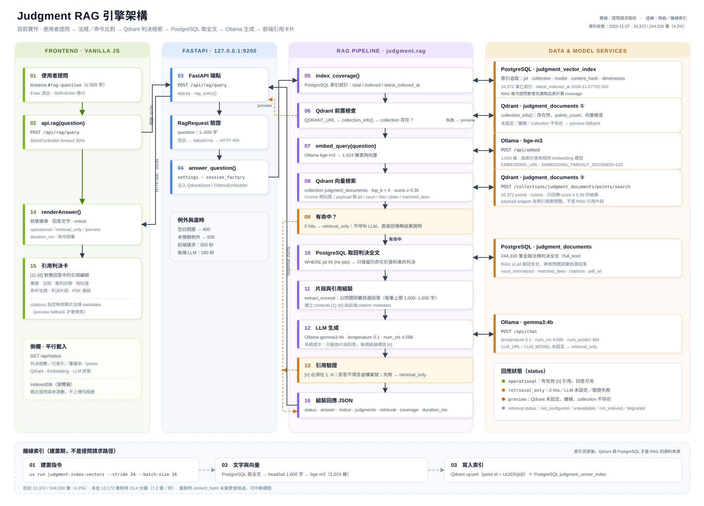
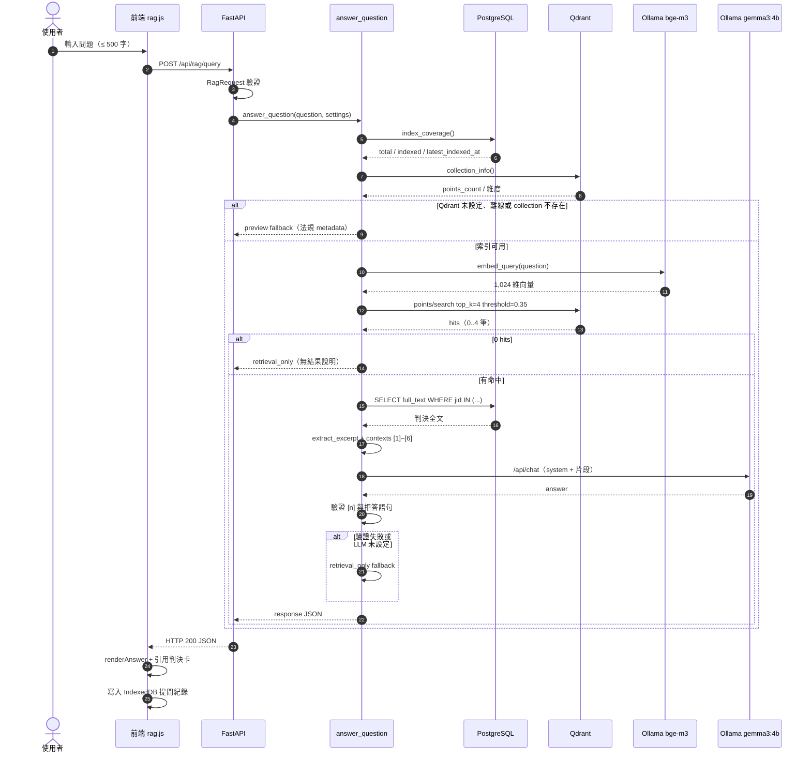

# Judgment RAG 引擎架構

> 從使用者提問、法規／命令比對、Qdrant 判決向量檢索、PostgreSQL 與 Parquet 取回全文，到 Ollama 生成回答並回到前端引用卡片的目前實作。
>
> 對應程式：`src/judgment/rag.py`、`src/judgment/law_rag.py`、`src/judgment/web/app.py`、`src/judgment/web/static/assets/js/pages/rag.js`



圖檔：`docs/rag-architecture.svg`（可直接用瀏覽器開啟，或內嵌於 Markdown／HTML）

## 1. 全域視圖

| 層 | 角色 | 主要元件 |
| --- | --- | --- |
| 前端 | 取得問題、顯示回答與引用 | Vanilla JS SPA、`pages/rag.js`、`api.js`、IndexedDB |
| API | 驗證請求、呼叫 RAG、回傳 JSON | FastAPI、`POST /api/rag/query`、Pydantic `RagRequest` |
| RAG 管線 | 法規／命令比對、檢索、取全文、組片段、生成、驗證 | `judgment.rag.answer_question()`、`judgment.law_rag` |
| 資料層 | 法規／命令 metadata、條文、判決全文與索引追蹤 | PostgreSQL `law_documents`、`judgment_documents`、`judgment_vector_index`；法規 Parquet 快照 |
| 向量層 | 文件級向量檢索 | Qdrant collection `judgment_documents` |
| 模型層 | 查詢 embedding 與回答生成 | Ollama `bge-m3`、`gemma3:4b`（快速預設） |

RAG **不是**直接把問題丟給 LLM。LLM 只會看到法規／命令條文，以及 Qdrant 檢索到、且仍存在於 PostgreSQL 的判決片段；回傳前還會檢查引用編號是否合法。法規／命令問題會先比對 `law_documents` 與法規 Parquet，不依賴判決索引覆蓋率。

## 2. 端到端流程

編號對應上方 SVG。

| # | 位置 | 動作 | 實作 |
| --- | --- | --- | --- |
| 01 | 前端 | 使用者輸入問題（≤ 500 字） | `#rag-question`、Enter 或「開始檢索」 |
| 02 | 前端 | `api.rag(question)` 呼叫 API | `api.js`：`POST /api/rag/query`，300 秒 AbortController |
| 03 | FastAPI | 接收請求 | `app.py`：`rag_query()` |
| — | FastAPI | `RagRequest` 驗證 | 空白或超過 500 字 → HTTP 400 |
| 04 | FastAPI | 呼叫 `answer_question()` | 傳入 `session_factory`、`settings` |
| 04a | RAG | 法規／命令名稱比對 | `find_law_records()`：`law_documents`、簡稱 alias（如 `證交法` → `證券交易法`） |
| 04b | RAG | 讀取法規條文與沿革 | `load_law_contents()`：最新 `laws.parquet` 的 `law_articles`、`law_histories` |
| 04c | RAG | 結構化問題或引用統計 | 條文數／制定日期／「最常觸犯」→ 直接以 metadata、條文與判決引用統計回答 |
| 05 | RAG | 讀取索引覆蓋率 | `index_coverage()`：`judgment_vector_index` 的 total／indexed |
| 06 | RAG | Qdrant 前置檢查 | `QdrantStore.collection_info()`：URL、連線、collection 是否存在；法規來源存在時不因 Qdrant 不可用而停擺 |
| 07 | RAG | 將問題轉為查詢向量 | `OllamaEmbedder.embed_query()` → `POST /api/embed` |
| 08 | RAG | 向量檢索 | `QdrantStore.search()`：`top_k=4`、`score_threshold=0.35` |
| 09 | RAG | 判斷是否有命中 | 0 hits 但有法規來源 → 使用法規／命令；兩者皆無 → `retrieval_only`，不呼叫 LLM |
| 10 | RAG | 取回判決全文 | PostgreSQL：`WHERE jid IN (...)`，只保留仍存在的判決 |
| 11 | RAG | 組裝片段與引用 | `extract_excerpt()`、`_build_citations()`、`law_source_text()`、`contexts [1]–[N]` |
| 12 | RAG | LLM 生成 | Ollama `POST /api/chat`：`gemma3:4b`、`temperature=0.1`、`num_ctx=4096`、`num_predict=384` |
| 13 | RAG | 引用驗證 | `_valid_citation_markers()`：`[n]` 必須在 `1..N`；拒答不得含虛構案號 |
| 14 | 前端 | 顯示回答 | `renderAnswer()`：狀態徽章、回答、notice、耗時 |
| 15 | 前端 | 顯示引用卡 | 判決卡：案號、法院、裁判日期、相似度、命中法規、片段、PDF；法規／命令卡：條文數、制定日期、條文、引用統計、來源 |
| 16 | RAG | 組裝回應 JSON | `status`、`answer`、`notice`、`judgments`、`law_sources`、`retrieval`、`coverage` |
| — | 前端 | 側欄與歷史 | `GET /api/status` 取覆蓋率；IndexedDB 存最近提問 |

## 3. 元件與程式位置

| 元件 | 檔案 | 責任 |
| --- | --- | --- |
| RAG 頁面 | `src/judgment/web/static/assets/js/pages/rag.js` | 問題輸入、呼叫 API、渲染回答與引用、側欄狀態、IndexedDB 歷史 |
| API 客戶端 | `src/judgment/web/static/assets/js/api.js` | `api.rag()`、`api.status()`、API base 與 timeout |
| HTTP 端點 | `src/judgment/web/app.py` | `POST /api/rag/query`、錯誤轉 HTTP 400／500、效能紀錄目標 |
| RAG 管線 | `src/judgment/rag.py` | `answer_question()`、`_search_hits()`、`_build_citations()`、`_generate_answer()`、引用驗證、fallback |
| Embedding | `src/judgment/embeddings.py` | Ollama `/api/embed`、模型存在檢查、向量維度驗證 |
| Qdrant 客戶端 | `src/judgment/vector_store.py` | collection 建立／查詢、payload index、`points/search` |
| 法規／命令 RAG | `src/judgment/law_rag.py` | 名稱／簡稱比對、Parquet 條文、制定日期、判決引用統計、結構化回答 |
| 索引器 | `src/judgment/judgment_index.py` | `build_index_text()`、`index_judgments()`、`index_coverage()`、`--stride` 抽樣 |
| 設定 | `src/judgment/config.py` | Qdrant、embedding、LLM、RAG 參數 |
| 資料模型 | `src/judgment/models.py` | `LawDocument`、`JudgmentDocument`、`JudgmentVectorIndex` |

## 4. 請求與回應契約

### 請求

```http
POST /api/rag/query
Content-Type: application/json
```

```json
{
  "question": "侵權行為損害賠償的舉證責任"
}
```

### 回應（成功且通過引用驗證）

```json
{
  "status": "operational",
  "answer": "根據判決片段，主張有利於己之事實者負有舉證責任 [1, 2, 3]。……這不是法律意見。",
  "notice": "回答只根據檢索到的法規／命令與判決片段生成，引用編號可對應下方來源。這不是法律意見。",
  "citations": [],
  "judgments": [
    {
      "index": 1,
      "jid": "TPDV,114,訴,1,20260101,1",
      "court": "臺灣臺北地方法院",
      "jdate": "20260101",
      "title": "清償借款",
      "score": 0.6123,
      "snippet": "原告主張……",
      "matched_laws": ["銀行法"],
      "citation_count": 3,
      "pdf_url": "https://data.judicial.gov.tw/..."
    }
  ],
  "law_sources": [
    {
      "index": 5,
      "law_name": "銀行法",
      "source_type": "law",
      "source_label": "法規",
      "article_count": 204,
      "law_modified_date": "20230628",
      "first_promulgation": {
        "roc_date": "中華民國二十年三月二十八日",
        "gregorian_date": "1931-03-28"
      },
      "articles": [
        {"article_no": "第29條", "article_content": "……"}
      ]
    }
  ],
  "matched_terms": ["銀行法"],
  "answer_source": "llm",
  "llm_model": "gemma3:4b",
  "embedding_model": "bge-m3",
  "retrieval": {
    "status": "ok",
    "latency_ms": 34,
    "top_k": 4,
    "score_threshold": 0.35,
    "hits": 4,
    "unique_judgments": 4,
    "law_hits": 1,
    "top_score": 0.6123
  },
  "coverage": {
    "total_judgments": 244330,
    "indexed_judgments": 10372,
    "remaining_judgments": 233958,
    "collection": "judgment_documents",
    "model": "bge-m3",
    "latest_indexed_at": "2026-11-07T02:56:25.139556+00:00"
  },
  "duration_ms": 2415
}
```

補充：

- `judgments` 是 RAG 的判決引用；`law_sources` 是法規／命令引用，包含 metadata、條文、制定日期與引用統計；`citations` 在一般 RAG 模式下固定為空陣列，只有 `preview` fallback 才會放法規 metadata。
- `answer_source` 為 `structured` 時，回答由法規／命令 metadata、條文與判決引用統計直接整理；為 `llm` 時由模型生成；為 `retrieval` 時只顯示檢索結果。
- `retrieval.hits` 是 Qdrant 原始命中數；`unique_judgments` 是去重後、實際進入片段組裝的判決數。
- `judgments[].snippet` 是 `extract_excerpt()` 從 PostgreSQL 全文挑出的片段，不是 Qdrant payload 的索引預覽。
- 前端以 `[n]` 對應 `judgments[].index`，因此回答中的編號可以直接回到底下的判決卡。
- 回答標頭在狀態與耗時旁顯示 `llm_model`（測試模式為 `test_run.primary_model`），tooltip 另列出 `embedding_model`；結構化回答顯示「法規資料庫」。

### 狀態值

| `status` | 意義 | LLM 是否呼叫 |
| --- | --- | --- |
| `operational` | 有檢索結果，LLM 回答通過引用驗證，或法規結構化回答成功 | 不一定（結構化回答不呼叫 LLM） |
| `retrieval_only` | 只回傳檢索結果或無結果說明 | 不一定（0 hits 時否；LLM 失敗時已呼叫但丟棄） |
| `preview` | Qdrant 不可用，降級為法規 metadata 預覽 | 否 |

`retrieval.status` 另外可能出現：

| 值 | 觸發條件 |
| --- | --- |
| `not_configured` | `QDRANT_URL` 未設定 |
| `unavailable` | Qdrant 無法連線 |
| `not_indexed` | collection 尚未建立 |
| `degraded` | Embedding 或 Qdrant 檢索過程發生錯誤 |
| `ok` | 檢索成功（不論 hits 是否為 0） |

HTTP 層：

- `400`：空白問題、超過 500 字、`ValueError`。
- `500`：`answer_question()` 拋出未預期例外。

## 5. 檢索與生成細節

### 5.1 查詢向量

- 模型：Ollama `bge-m3`（1,024 維，與索引使用同一個模型）。
- 端點：`POST {EMBEDDING_URL}/api/embed`。
- 前端問題直接作為 embedding 輸入，不做關鍵字查詢改寫。

### 5.2 Qdrant 檢索

- Collection：`judgment_documents`。
- 距離：Cosine。
- 參數：`top_k=4`、`score_threshold=0.35`。
- 每個 point 對應一筆判決，point id 為 `uuid5(NAMESPACE_URL, "judgment:<jid>")`，重跑為 idempotent upsert。
- Payload：`jid`、`court`、`title`、`jdate`、`matched_laws`、`citation_count`、`source_archive`、`pdf_url`、`full_text_length`、`snippet`、`model`。
- `snippet` 是索引文字的前 600 字預覽；RAG 回答不使用它，而是回到 PostgreSQL 取全文。

### 5.3 全文與片段

- 以 Qdrant 命中的 `jid` 到 PostgreSQL `judgment_documents` 取回 `full_text`。
- 若判決已從 PostgreSQL 刪除但 Qdrant 仍有 point，該筆會被跳過；全部被跳過時回傳 `retrieval_only`，不生成答案。
- `extract_excerpt()` 以問題中的中文雙字詞與英文詞彙計分，挑選最相關段落；每筆判決的預算為 `max(600, RAG_MAX_CONTEXT_CHARS / 命中數)`，上限 1,600 字。
- 目前 4 筆命中時，每筆約 1,000 字，總上下文約 4,000 字。

點擊判決引用卡內容（`citation-body`）會走 `GET /api/judgment?source=parquet`，從 `data/judgments/parquet/judgments/.../judgments.parquet` 依 `jid` 讀取完整判決並以 dialog 顯示；RAG 生成仍使用 PostgreSQL 的全文，不由 Parquet 取代。

### 5.4 LLM 生成

- 端點：`POST {LLM_URL}/api/chat`。
- 模型：`gemma3:4b`（可由 `LLM_MODEL` 改成 27B 品質模式）。
- 參數：`temperature=0.1`、`num_ctx=4096`、`num_predict=384`、`keep_alive=30m`、`stream=false`。
- 系統提示要求：
  - 只能根據提供的判決片段回答。
  - 不得創造案號、法院、日期或法條。
  - 每個結論後標註 `[n]`。
  - 片段不足時直接說「檢索到的判決片段不足以回答」。
  - 使用繁體中文，2–4 句，並提醒不是法律意見。

### 5.5 引用驗證

`_valid_citation_markers(answer, N)` 的規則：

1. 解析 `[1]`、`[1, 2, 3]`、`[1，2]` 等格式。
2. 所有編號必須落在 `1..N`。
3. 若沒有任何編號，只有當回答包含「不足以回答／無法回答／沒有足夠／查無相關／未提及／無法判斷」等明確拒答語句，且不含案號格式時，才視為合法。
4. 驗證失敗 → `retrieval_only`，改用 `_retrieval_answer()` 顯示檢索摘要，不保留 LLM 的回答。

### 5.6 測試模式

當 PostgreSQL `app_settings.test_mode` 為 ON 時，`answer_question()` 在 Qdrant collection 檢查完成後分支到 `performance_test.run_test_mode()`：

1. 從 Ollama `/api/tags` 自動偵測 embedding 與 LLM 模型，排除 reranker。
2. 依序對每個 embedding 模型執行 embedding 與 Qdrant 檢索。
3. 以設定的參考 embedding 模型取回 PostgreSQL 全文與 contexts。
4. 依序對每個 LLM 模型執行生成與引用驗證；embedding 與 LLM 呼叫皆使用 `timeout=None`。
5. 每個階段／模型寫入 `performance_test_steps`，整體寫入 `performance_test_runs`；效能報表頁會 polling 顯示即時 Flow。
6. 主要回答優先使用 `LLM_MODEL`，其次使用第一個通過引用驗證的模型；全部失敗時降級為 `retrieval_only`。

測試模式的模型清單與流程圖表細節見 `README.md` 的〈測試模式與模型測試 Flow〉。


| 情況 | `status` | `retrieval.status` | 前端行為 |
| --- | --- | --- | --- |
| 一切正常、LLM 回答有合法 `[n]` | `operational` | `ok` | 顯示回答與 4 筆判決卡 |
| Qdrant 有結果，但 LLM 未設定 | `retrieval_only` | `ok` | 顯示檢索摘要與判決卡，不生成答案 |
| Qdrant 有結果，LLM 失敗或引用無效 | `retrieval_only` | `ok` | 顯示降級 notice、檢索摘要與判決卡 |
| Qdrant 無相似度足夠的判決 | `retrieval_only` | `ok`（hits=0） | 顯示無結果說明，不呼叫 LLM |
| `QDRANT_URL` 未設定 | `preview` | `not_configured` | 顯示法規 metadata 預覽 |
| Qdrant 無法連線 | `preview` | `unavailable` | 顯示法規 metadata 預覽 |
| collection 尚未建立 | `preview` | `not_indexed` | 提示先執行 `judgment-index-vectors` |
| Embedding／Qdrant 檢索失敗 | `preview` | `degraded` | 顯示法規 metadata 預覽 |
| 空白問題或超過 500 字 | HTTP 400 | — | 前端顯示錯誤 toast／錯誤卡 |
| 未預期例外 | HTTP 500 | — | 前端顯示錯誤卡 |

`preview` fallback 會呼叫 `web.query.rag_preview()`，只比對現行法規名稱與 metadata，不會生成判決答案。

## 7. 離線索引流程

RAG 的資料來源不是即時從判決壓縮檔讀取，而是先建立索引：

```text
PostgreSQL judgment_documents
  → build_index_text()：法院、日期、案由、命中法規、全文 head/tail（1,600 字）
  → Ollama bge-m3 /api/embed（1,024 維）
  → Qdrant upsert（point id = UUID5(jid)）
  → PostgreSQL judgment_vector_index（jid、collection、model、content_hash、dimensions、indexed_at）
```

指令：

```bash
# 只統計，不呼叫 Ollama／Qdrant
uv run judgment-index-vectors --dry-run --limit 1000

# 建立前 1,000 筆
uv run judgment-index-vectors --limit 1000 --batch-size 16

# 跨語料抽樣（目前使用；id 為 24 的倍數）
uv run judgment-index-vectors --stride 24 --batch-size 16

# 續跑剩餘判決（已索引且 content_hash 未變更會跳過）
uv run judgment-index-vectors --all --batch-size 16

# 重建整個 collection
uv run judgment-index-vectors --recreate --batch-size 16
```

目前狀態：

| 項目 | 數值 |
| --- | --- |
| 判決總數 | 244,330 |
| 已索引 | 10,372 |
| 覆蓋率 | 4.2% |
| Qdrant points | 10,372 |
| 向量維度 | 1,024 |
| 索引模型 | `bge-m3` |
| 本批耗時 | 23.4 分鐘（10,172 筆，約 7.2 筆／秒） |

## 8. 目前設定

| 變數 | 目前值 | 用途 |
| --- | --- | --- |
| `QDRANT_URL` | `http://127.0.0.1:6333` | Qdrant REST |
| `JUDGMENT_VECTOR_COLLECTION` | `judgment_documents` | 文件級向量 collection |
| `EMBEDDING_URL` | `http://127.0.0.1:11434` | Ollama API |
| `EMBEDDING_MODEL` | `bge-m3` | 查詢與索引 embedding |
| `EMBEDDING_TIMEOUT_SECONDS` | `120` | Embedding 請求逾時 |
| `LLM_URL` | `http://127.0.0.1:11434` | Ollama API |
| `LLM_MODEL` | `gemma3:4b` | 快速預設回答模型；品質優先可改 27B |
| `LLM_TIMEOUT_SECONDS` | `180` | LLM 請求逾時 |
| `LLM_NUM_CTX` | `4096` | Ollama context window |
| `LLM_NUM_PREDICT` | `384` | 最多生成 tokens |
| `LLM_KEEP_ALIVE` | `30m` | 模型保持載入時間 |
| `RAG_TOP_K` | `4` | 檢索候選數 |
| `RAG_SCORE_THRESHOLD` | `0.35` | 相似度下限 |
| `RAG_MAX_CONTEXT_CHARS` | `4000` | 提供給 LLM 的片段總預算 |
| `JUDGMENT_INDEX_MAX_CHARS` | `1600` | 每筆判決索引文字上限 |

## 9. 循序圖



## 10. 已知限制

1. **索引覆蓋率只有 4.2%**：目前是 `--stride 24` 抽樣索引（10,372／244,330）。未被索引的判決不會出現在檢索結果中；覆蓋率會誠實顯示在 RAG 側欄與狀態頁。
2. **文件級向量而非片段級**：每筆判決只取 head/tail 1,600 字作為 embedding，判決中段的細節可能不會被檢索到。
3. **沒有 reranker**：Qdrant cosine 分數直接決定候選順序；沒有 cross-encoder 或 bge-reranker 重新排序。
4. **引用驗證是結構驗證**：只檢查 `[n]` 是否落在範圍內、拒答是否含案號；不驗證每個句子是否真的由對應片段支持。
5. **LLM 生成速度與品質權衡**：快速 profile（`gemma3:4b`、top_k=4、4,000 字上下文、num_ctx=4096）實測整體 RAG 約 2–5 秒；切回 `gemma3:27b` 約 30–50 秒。一般模式前端等待上限為 300 秒，測試模式則對 embedding 與 LLM 使用無 timeout。4B 的複雜推理品質可能低於 27B，可透過 `LLM_MODEL` 切換。
6. **非串流回應**：`stream=false`，使用者要等完整回答生成後才會看到結果。
7. **Qdrant 與 PostgreSQL 可能短暫不同步**：索引器先寫 Qdrant 再寫 `judgment_vector_index`；RAG 以 PostgreSQL 全文為最終依據，找不到的判決會被跳過。
8. **沒有使用者認證**：API 目前是唯讀，但若透過 tunnel 對外開放，任何知道網址的人都能提問；正式部署應加上存取控制與速率限制。

## 11. 驗證方式

```bash
# 單元測試：索引器、續跑、RAG 引用驗證、fallback
uv run pytest tests/test_rag.py -q

# 全部測試與靜態檢查
uv run pytest -q
uv run ruff check .

# 直接呼叫 API
curl -s http://127.0.0.1:9200/api/rag/query \
  -H 'Content-Type: application/json' \
  -d '{"question":"侵權行為損害賠償的舉證責任"}'
```

前端驗證重點：

- RAG 側欄顯示判決總數、已索引、覆蓋率、points、Qdrant／Embedding／LLM 狀態。
- 回答卡顯示狀態徽章、回答、notice 與引用判決卡。
- 引用卡的 `[n]` 與回答中的編號一致。
- 390px 寬度沒有水平溢出，瀏覽器 console 沒有錯誤。
- Qdrant 資料頁的語意查詢可點選案號開啟判決原文，返回後查詢條件保留。

## 12. 相關文件

- `README.md`：安裝、啟動、索引指令、降級矩陣與驗證紀錄。
- `specs/004-web-console/spec.md`：Web 主控台規格與 RAG 驗收條件。
- `docs/rag-architecture.svg`：本文件使用的架構圖。
