# Case Assessment Data Dictionary v1.0

- **Project:** ragdemo.win
- **Module:** Case Assessment & Legal Strategy Engine（CASE）
- **Document version:** 1.0.0-draft
- **Date:** 2026-11-08
- **Status:** Reference data dictionary — 尚未實作
- **Related:** `documents/CASE_ASSESSMENT_FEASIBILITY_v1.0.md`
- **Scope:** CASE v1.0 的 Domain Model、資料型別、關聯、Provenance、版本與現有資料對照

> 本文件是未來「專案評估／案件評估」功能的資料契約參考，不是資料庫 migration，也不表示 CASE 已進入開發。實作前仍需完成 Auth、Storage、Tenant、條文版本與 Feature Schema 的架構決策。

---

## 1. 文件目的

本文件定義 CASE v1.0 所需的資料實體、欄位、型別、關聯、來源與版本規則，目的為：

1. 避免 CASE 與現有法規／判決資料模型重複。
2. 讓事實、證據、法律要件、判決比較與策略結果可追溯。
3. 讓每次分析可重現、可比較、可人工覆核。
4. 作為未來 PostgreSQL migration、API contract、LLM extraction schema 與前端表單的共同參考。
5. 作為 Financial Legal Feature Schema 與 CM2／CM3 Provenance 對照的基礎。

---

## 2. 設計慣例

### 2.1 識別碼

| 項目 | 規則 |
|---|---|
| CASE 實體 ID | UUID v4，儲存為 `String(36)`；避免 SQLite／PostgreSQL 差異 |
| 既有法規 ID | `Integer`，對應 `law_documents.id` |
| 既有法規版本 ID | `Integer`，對應 `law_dataset_versions.id` |
| 既有判決 ID | `Integer`，對應 `judgment_documents.id`；另存 `judgment_jid` 作穩定外部鍵 |
| 時間 | `DateTime(timezone=True)`，統一 UTC；API 輸出 ISO 8601 |
| 日期 | `Date`；不確定的日期另存 `date_precision` |
| 金額 | `Numeric(18, 2)` + `currency`；避免浮點誤差 |
| 信心度 | `Numeric(5, 4)`，範圍 0.0000–1.0000 |
| 列舉 | `String(32)` + 應用層 Enum；不使用 PostgreSQL ENUM，降低 migration 成本 |
| 多值欄位 | `JSON`；PostgreSQL 可評估改為 `JSONB` |
| 文件內容 | 不存 DB blob；存 `storage_location`、`content_hash` |

### 2.2 共用欄位

**STD-M（可變實體）**

| 欄位 | 型別 | 必填 | 說明 |
|---|---|---|---|
| id | String(36) | 是 | PK，UUID |
| created_at | DateTime(tz) | 是 | 建立時間 UTC |
| updated_at | DateTime(tz) | 是 | 更新時間 UTC |
| created_by | String(128) | 否 | 使用者 subject／系統帳號；Auth 完成前可為 null |
| updated_by | String(128) | 否 | 最後更新者 |
| row_version | Integer | 是 | 樂觀鎖定，預設 1 |
| archived_at | DateTime(tz) | 否 | 封存時間；分析結果不使用 |
| deleted_at | DateTime(tz) | 否 | 軟刪除時間；分析結果不使用 |
| metadata | JSON | 否 | 擴充欄位，預設 `{}` |

**STD-I（不可變分析實體）**

| 欄位 | 型別 | 必填 | 說明 |
|---|---|---|---|
| id | String(36) | 是 | PK，UUID |
| created_at | DateTime(tz) | 是 | 建立時間 UTC |
| created_by | String(128) | 否 | 產生者／系統帳號 |
| metadata | JSON | 否 | 擴充欄位，預設 `{}` |

> 分析結果（Analysis Run、Artifact、Assessment、Risk、Strategy、Scenario）以新增版本取代覆寫；不得原地修改歷史結果。

### 2.3 刪除與保存

- 案件、當事人、文件、事實、爭點、證據：可使用 `archived_at`／`deleted_at` 軟刪除。
- Analysis Run 與報告：不可刪除；以 `status`、`is_current`、`superseded_by` 管理。
- 原始文件與 provenance：依保存政策保留；不得因刪除案件而破壞已產出報告的來源追溯。
- 審計紀錄：不可修改。

### 2.4 文字位置

- `source_start_offset`／`source_end_offset` 使用 **Unicode code point offset**（Python 字串索引），不是 byte offset。
- 必須同時保存 `source_hash`；若原文變動，offset 不得直接沿用。
- OCR 文字與原始 PDF 頁碼需另存 `page_number`／`ocr_confidence`。

---

## 3. 列舉值

| Enum | 允許值 |
|---|---|
| case_status | draft, intake, fact_review, issue_analysis, evidence_analysis, precedent_analysis, assessment, strategy_review, completed, archived |
| case_type | banking, securities, futures, insurance, bonds, corporate_finance, financial_consumer, payment_and_settlement, financial_transaction, other |
| confidentiality | public, internal, confidential, highly_confidential |
| party_type | individual, legal_entity, institution, government, unknown |
| legal_role | plaintiff, defendant, claimant, respondent, creditor, debtor, investor, broker, financial_institution, insurer, insured, agent, regulator, witness, other |
| fact_type | transaction, communication, agreement, payment, authorization, representation, omission, damage, relationship, procedural_event, other |
| source_type | user_statement, uploaded_document, official_record, opposing_party_statement, court_finding, system_extraction, external_source |
| verification_status | unverified, partially_verified, verified, disputed, rejected |
| date_precision | day, month, year, approximate, unknown |
| document_type | contract, transaction_record, bank_statement, email, message, meeting_record, financial_statement, official_document, court_document, expert_report, other |
| processing_status | uploaded, extracting, extracted, failed, reviewed |
| issue_type | contract_validity, contractual_breach, tort_liability, fiduciary_duty, disclosure_obligation, suitability, fraud, negligence, causation, damages, regulatory_compliance, procedural_issue, other |
| issue_status | candidate, confirmed, analyzing, resolved, excluded |
| element_status | supported, partially_supported, unsupported, disputed, unknown, not_applicable |
| evidence_status | available, incomplete, disputed, contradictory, missing, not_relevant |
| evidence_link_type | supports, contradicts, contextual, rebuts, proves_damage, proves_notice, proves_authorization, other |
| precedent_role | favorable_precedent, unfavorable_precedent, mixed_precedent, distinguishable_precedent, conflicting_interpretation_candidate |
| risk_dimension | legal, evidence, procedural, financial_exposure, regulatory, reputational, operational |
| risk_level | low, moderate, high, critical, undetermined |
| strategy_type | negotiation, settlement, partial_compensation, formal_complaint, regulatory_response, litigation, defense, evidence_collection, internal_remediation, transaction_restructuring, other |
| run_type | fact_extraction, issue_analysis, evidence_analysis, precedent_search, assessment, strategy, scenario, full_report |
| run_status | queued, running, success, failed, cancelled, stale |
| assessment_status | supported, partially_supported, contradicted, insufficient_evidence, not_applicable, unknown |
| review_decision | approved, needs_changes, rejected, escalated |
| artifact_type | report_json, report_html, report_pdf, evidence_matrix, strategy_matrix, comparison_json |
| feature_status | draft, active, deprecated |
| case_member_role | owner, editor, reviewer, viewer, admin |

---

## 4. 實體關聯圖

```mermaid
erDiagram
    CASES ||--o{ CASE_MEMBERS : authorizes
    CASES ||--o{ CASE_PARTIES : contains
    CASES ||--o{ CASE_DOCUMENTS : contains
    CASES ||--o{ CASE_FACTS : contains
    CASES ||--o{ CASE_EVENTS : contains
    CASES ||--o{ LEGAL_ISSUES : contains
    CASES ||--o{ CASE_EVIDENCE : contains
    CASES ||--o{ CASE_LAWS : applies
    CASES ||--o{ ANALYSIS_RUNS : executes

    CASE_DOCUMENTS ||--o{ DOCUMENT_CHUNKS : chunks
    CASE_FACTS ||--o{ CASE_FACT_REVISIONS : revisions
    CASE_FACTS ||--o{ CASE_FACT_CONFLICTS : conflicts
    LEGAL_ISSUES ||--o{ LEGAL_ELEMENTS : elements
    LEGAL_ISSUES ||--o{ CASE_ISSUE_FACTS : facts
    LEGAL_ISSUES ||--o{ CASE_PRECEDENTS : compares
    CASE_EVIDENCE ||--o{ EVIDENCE_LINKS : links
    ANALYSIS_RUNS ||--o{ CASE_PRECEDENTS : retrieves
    ANALYSIS_RUNS ||--o{ CASE_ASSESSMENTS : assesses
    ANALYSIS_RUNS ||--o{ CASE_RISKS : identifies
    ANALYSIS_RUNS ||--o{ CASE_STRATEGIES : proposes
    ANALYSIS_RUNS ||--o{ CASE_SCENARIOS : models
    ANALYSIS_RUNS ||--o{ ANALYSIS_ARTIFACTS : produces
    ANALYSIS_RUNS ||--o{ HUMAN_REVIEWS : reviews
    FEATURE_SCHEMAS ||--o{ FEATURE_VALUES : defines
    EVALUATION_DATASETS ||--o{ EVALUATION_CASES : contains
    EVALUATION_DATASETS ||--o{ EVALUATION_RESULTS : reports
```

---

## 5. 案件核心

### 5.1 `cases`

案件根節點。套用 **STD-M**。

| 欄位 | 型別 | 必填 | 說明 |
|---|---|---|---|
| title | String(300) | 是 | 案件名稱 |
| description | Text | 否 | 案件摘要 |
| case_type | String(32) | 是 | 見 `case_type` |
| jurisdiction | String(100) | 否 | 管轄地區／法院層級 |
| event_start_date | Date | 否 | 事件起始日 |
| event_end_date | Date | 否 | 事件結束日 |
| status | String(32) | 是 | 見 `case_status` |
| owner_id | String(128) | 否 | Auth subject；Auth 前可為 null |
| confidentiality | String(32) | 是 | 預設 `confidential` |
| current_analysis_run_id | String(36) | 否 | 最新成功 Analysis Run；FK 於 migration 後加 |

索引：`(owner_id, status)`、`(case_type, status)`、`(event_start_date)`。

### 5.2 `case_members`

案件層級授權。套用 **STD-I**；`id` 可省略，使用複合 PK。

| 欄位 | 型別 | 必填 | 說明 |
|---|---|---|---|
| case_id | String(36) | 是 | FK → cases.id |
| user_id | String(128) | 是 | Google subject／內部帳號 |
| role | String(32) | 是 | 見 `case_member_role` |
| granted_by | String(128) | 否 | 授權者 |
| granted_at | DateTime(tz) | 是 | 授權時間 |
| expires_at | DateTime(tz) | 否 | 選用 |

PK：`(case_id, user_id)`。所有案件 API 必須 server-side 檢查，不可只依賴前端；角色變更應新增授權紀錄，不直接覆寫歷史。

### 5.3 `case_parties`

套用 **STD-M**。

| 欄位 | 型別 | 必填 | 說明 |
|---|---|---|---|
| case_id | String(36) | 是 | FK → cases.id |
| party_type | String(32) | 是 | 見 `party_type` |
| display_name | String(300) | 是 | 顯示名稱；必要時遮罩 |
| legal_role | String(32) | 是 | 見 `legal_role` |
| description | Text | 否 | 補充說明 |
| identifiers | JSON | 否 | 去識別化後的識別資料；不得存不必要個資 |
| provenance_id | String(36) | 否 | FK → provenance_records.id |

索引：`(case_id, legal_role)`。

### 5.4 `case_documents`

套用 **STD-M**。

| 欄位 | 型別 | 必填 | 說明 |
|---|---|---|---|
| case_id | String(36) | 是 | FK → cases.id |
| filename | String(500) | 是 | 原始檔名 |
| mime_type | String(128) | 是 | 驗證後的 MIME |
| content_hash | String(64) | 是 | SHA-256；原始檔不可變 |
| storage_location | Text | 是 | 相對路徑／物件鍵；不可公開 |
| document_type | String(32) | 是 | 見 `document_type` |
| processing_status | String(32) | 是 | 見 `processing_status` |
| page_count | Integer | 否 | PDF 頁數 |
| language | String(16) | 否 | 主要語言 |
| confidentiality | String(32) | 是 | 預設同案件 |
| uploaded_at | DateTime(tz) | 是 | 上傳時間 |
| provenance_id | String(36) | 否 | 文件來源／匯入批次 |

索引：`(case_id, document_type)`、`(content_hash)`。

### 5.5 `document_chunks`

提供 Qdrant 與證據定位。套用 **STD-M**。

| 欄位 | 型別 | 必填 | 說明 |
|---|---|---|---|
| document_id | String(36) | 是 | FK → case_documents.id |
| chunk_index | Integer | 是 | 文件內序號 |
| text | Text | 是 | 抽取後文字 |
| page_number | Integer | 否 | PDF 頁碼 |
| start_offset | Integer | 是 | 文件全文中的 code point 起點 |
| end_offset | Integer | 是 | code point 終點（不含） |
| token_count | Integer | 否 | 模型 token 數 |
| content_hash | String(64) | 是 | chunk 文字 SHA-256 |
| qdrant_collection | String(128) | 否 | 私有 collection 名稱 |
| qdrant_point_id | String(64) | 否 | Qdrant point ID |
| embedding_model | String(128) | 否 | 產生向量的模型 |
| ocr_confidence | Numeric(5,4) | 否 | OCR 信心度 |

唯一鍵：`(document_id, chunk_index)`。索引：`(qdrant_collection, qdrant_point_id)`。

---

## 6. 事實、事件與 Provenance

### 6.1 `case_facts`

套用 **STD-M**。

| 欄位 | 型別 | 必填 | 說明 |
|---|---|---|---|
| case_id | String(36) | 是 | FK → cases.id |
| current_revision_id | String(36) | 否 | 最新 revision；FK 於 migration 後加 |
| fact_type | String(32) | 是 | 見 `fact_type` |
| event_date | Date | 否 | 事實發生日期 |
| date_precision | String(16) | 是 | 見 `date_precision` |
| verification_status | String(32) | 是 | 見 `verification_status` |
| confidence | Numeric(5,4) | 否 | 抽取信心度，不是法律判斷 |
| provenance_id | String(36) | 否 | 主要來源 |

索引：`(case_id, verification_status)`、`(case_id, event_date)`。

### 6.2 `case_fact_revisions`

事實不可覆寫；每次修正建立 revision。套用 **STD-I**。

| 欄位 | 型別 | 必填 | 說明 |
|---|---|---|---|
| fact_id | String(36) | 是 | FK → case_facts.id |
| revision_no | Integer | 是 | 從 1 遞增 |
| fact_text | Text | 是 | 該版本事實文字 |
| change_reason | Text | 否 | 修改原因 |
| provenance_id | String(36) | 否 | 來源與抽取方法 |

唯一鍵：`(fact_id, revision_no)`。

### 6.3 `case_events`

時間軸事件；可連到事實。套用 **STD-M**。

| 欄位 | 型別 | 必填 | 說明 |
|---|---|---|---|
| case_id | String(36) | 是 | FK → cases.id |
| fact_id | String(36) | 否 | FK → case_facts.id |
| event_date | Date | 否 | 事件日期 |
| date_precision | String(16) | 是 | 見 `date_precision` |
| event_type | String(64) | 是 | 交易、通訊、付款、訴訟程序等 |
| description | Text | 是 | 事件描述 |
| sequence_no | Integer | 否 | 同日排序 |
| provenance_id | String(36) | 否 | 來源 |

索引：`(case_id, event_date, sequence_no)`。

### 6.4 `case_fact_conflicts`

| 欄位 | 型別 | 必填 | 說明 |
|---|---|---|---|
| case_id | String(36) | 是 | FK → cases.id |
| fact_a_id | String(36) | 是 | FK → case_facts.id |
| fact_b_id | String(36) | 是 | FK → case_facts.id |
| conflict_type | String(32) | 是 | contradiction, temporal, identity, amount, other |
| description | Text | 是 | 衝突說明 |
| resolution_status | String(32) | 是 | open, resolved, accepted_ambiguity |
| resolved_fact_id | String(36) | 否 | 採用的版本／事實 |

### 6.5 `provenance_records`

通用來源追溯表。套用 **STD-I**。這是 CASE 的核心治理表，不可省略。

| 欄位 | 型別 | 必填 | 說明 |
|---|---|---|---|
| entity_type | String(64) | 是 | fact_revision, evidence, legal_element, case_precedent, assessment, risk, strategy, feature_value |
| entity_id | String(255) | 是 | 對應實體 ID；可存 CASE UUID 或 JID |
| source_type | String(32) | 是 | 見 `source_type` |
| source_document_id | String(36) | 否 | FK → case_documents.id |
| source_chunk_id | String(36) | 否 | FK → document_chunks.id |
| source_start_offset | Integer | 否 | code point 起點 |
| source_end_offset | Integer | 否 | code point 終點 |
| source_hash | String(64) | 否 | 來源段落／文件 SHA-256 |
| extraction_method | String(64) | 是 | manual, regex, rule_engine, llm, ocr, external_api |
| model_provider | String(64) | 否 | 例如 ollama、openai、local |
| model_name | String(128) | 否 | 模型名稱 |
| model_version | String(128) | 否 | 模型版本／digest |
| prompt_version | String(64) | 否 | Prompt 版本 |
| confidence | Numeric(5,4) | 否 | 抽取信心度 |
| verification_status | String(32) | 是 | 見 `verification_status` |
| note | Text | 否 | 人工備註 |

索引：`(entity_type, entity_id)`、`(source_document_id)`、`(source_hash)`。

---

## 7. 法律分析

### 7.1 `legal_issues`

套用 **STD-M**。

| 欄位 | 型別 | 必填 | 說明 |
|---|---|---|---|
| case_id | String(36) | 是 | FK → cases.id |
| title | String(300) | 是 | 爭點名稱 |
| description | Text | 否 | 爭點說明 |
| legal_domain | String(64) | 否 | 民事、刑事、行政、金融監理等 |
| issue_type | String(32) | 是 | 見 `issue_type` |
| priority | String(16) | 是 | high, medium, low |
| status | String(32) | 是 | 見 `issue_status` |
| provenance_id | String(36) | 否 | 爭點來源 |

索引：`(case_id, status)`、`(case_id, issue_type)`。

### 7.2 `legal_elements`

套用 **STD-M**。

| 欄位 | 型別 | 必填 | 說明 |
|---|---|---|---|
| issue_id | String(36) | 是 | FK → legal_issues.id |
| element_key | String(64) | 是 | 穩定要件鍵，如 `disclosure`、`causation` |
| title | String(300) | 是 | 要件名稱 |
| definition | Text | 是 | 法律要件說明 |
| legal_basis_text | Text | 否 | 法條／實務見解摘要 |
| element_status | String(32) | 是 | 見 `element_status` |
| burden_of_proof | Text | 否 | 舉證責任說明；需專業確認 |
| provenance_id | String(36) | 否 | 法律依據來源 |

唯一鍵：`(issue_id, element_key)`。

### 7.3 `case_laws`

案件適用法規與條文版本。套用 **STD-M**。

| 欄位 | 型別 | 必填 | 說明 |
|---|---|---|---|
| case_id | String(36) | 是 | FK → cases.id |
| issue_id | String(36) | 否 | FK → legal_issues.id |
| law_id | Integer | 是 | FK → law_documents.id |
| law_key | String(512) | 是 | 冗餘穩定鍵，方便外部引用 |
| law_version_id | Integer | 是 | FK → law_dataset_versions.id |
| article_key | String(256) | 否 | `<law_key>#<article_type>:<article_no>` |
| article_label | String(128) | 否 | 例如「第 19 條」 |
| relationship | String(32) | 是 | applies, cites, interprets, violates, excludes, related |
| direct_applicability | Boolean | 是 | 法院是否直接適用 |
| temporal_match | String(16) | 是 | match, mismatch, unknown |
| provenance_id | String(36) | 否 | 引用段落 |

索引：`(case_id, law_id)`、`(law_version_id, article_key)`。

> 目前 `law_articles` 存在於法規 Parquet／JSON；尚未有 PostgreSQL 條文版本表。`article_key` 的穩定性需與 `law_article_versions` 或 Parquet snapshot 方案一起確認。

### 7.4 `case_issue_facts`

| 欄位 | 型別 | 必填 | 說明 |
|---|---|---|---|
| id | String(36) | 是 | PK |
| issue_id | String(36) | 是 | FK → legal_issues.id |
| fact_id | String(36) | 是 | FK → case_facts.id |
| role | String(32) | 是 | supporting, adverse, contextual |
| provenance_id | String(36) | 否 | 關聯來源 |
| created_at | DateTime(tz) | 是 | 建立時間 |

唯一鍵：`(issue_id, fact_id, role)`。

### 7.5 `case_evidence`

套用 **STD-M**。

| 欄位 | 型別 | 必填 | 說明 |
|---|---|---|---|
| case_id | String(36) | 是 | FK → cases.id |
| document_id | String(36) | 否 | FK → case_documents.id |
| evidence_type | String(64) | 是 | contract, transaction_record, message, expert_report 等 |
| title | String(300) | 是 | 證據名稱 |
| description | Text | 否 | 證據說明 |
| evidence_status | String(32) | 是 | 見 `evidence_status` |
| source_type | String(32) | 是 | 見 `source_type` |
| provenance_id | String(36) | 否 | 來源 |

索引：`(case_id, evidence_status)`、`(document_id)`。

### 7.6 `evidence_links`

證據與事實／要件／爭點的關聯。套用 **STD-M**。

| 欄位 | 型別 | 必填 | 說明 |
|---|---|---|---|
| evidence_id | String(36) | 是 | FK → case_evidence.id |
| target_type | String(32) | 是 | fact, legal_element, legal_issue |
| target_id | String(36) | 是 | 目標實體 ID |
| link_type | String(32) | 是 | 見 `evidence_link_type` |
| strength | Numeric(5,4) | 否 | 支持／反對強度；需說明方法 |
| notes | Text | 否 | 關聯理由 |
| provenance_id | String(36) | 否 | 判斷來源 |

唯一鍵：`(evidence_id, target_type, target_id, link_type)`。

### 7.7 `case_precedents`

判決比較結果；每次 Analysis Run 建立新資料。套用 **STD-I**。

| 欄位 | 型別 | 必填 | 說明 |
|---|---|---|---|
| analysis_run_id | String(36) | 是 | FK → analysis_runs.id |
| issue_id | String(36) | 否 | FK → legal_issues.id |
| judgment_jid | String(255) | 是 | 對應 `judgment_documents.jid` |
| judgment_document_id | Integer | 否 | 對應 `judgment_documents.id` |
| precedent_role | String(64) | 是 | 見 `precedent_role` |
| financial_domain_match | Boolean | 否 | 金融業務是否相同 |
| transaction_type_match | Boolean | 否 | 交易類型是否相同 |
| legal_issue_match | Boolean | 否 | 爭點是否相同 |
| applicable_law_match | Boolean | 否 | 適用法規是否相同 |
| fact_similarity | Numeric(5,4) | 否 | 事實相似度；需標明方法 |
| reasoning_similarity | Numeric(5,4) | 否 | 裁判理由相似度 |
| similarity_score | Numeric(5,4) | 否 | 綜合檢索分數，不是法律責任分數 |
| outcome | String(128) | 否 | 裁判結果摘要 |
| procedural_stage | String(64) | 否 | 程序階段 |
| comparison_summary | Text | 否 | 相似點／差異點 |
| supporting_passage | Text | 否 | 引用段落摘要 |
| provenance_id | String(36) | 否 | 判決原文位置 |

唯一鍵：`(analysis_run_id, issue_id, judgment_jid)`。索引：`(judgment_jid)`。

---

## 8. 分析執行與治理

### 8.1 `analysis_runs`

套用 **STD-M**；分析結果不可覆寫，但 status 可更新。

| 欄位 | 型別 | 必填 | 說明 |
|---|---|---|---|
| case_id | String(36) | 是 | FK → cases.id |
| run_type | String(32) | 是 | 見 `run_type` |
| status | String(32) | 是 | 見 `run_status` |
| requested_by | String(128) | 否 | 使用者／系統 |
| started_at | DateTime(tz) | 是 | 開始時間 |
| completed_at | DateTime(tz) | 否 | 完成時間 |
| input_snapshot | JSON | 是 | 案件、文件 hash、事實 revision、法規版本等 |
| feature_schema_version | String(32) | 否 | Feature Schema 版本 |
| legal_data_version_id | Integer | 否 | FK → law_dataset_versions.id |
| judgment_data_version | String(64) | 否 | 判決資料快照／匯入版本或品質 fingerprint |
| retrieval_config | JSON | 否 | Qdrant collection、top_k、filters、reranker |
| embedding_model | String(128) | 否 | embedding 模型 |
| llm_provider | String(64) | 否 | ollama, openai, local |
| llm_model | String(128) | 否 | LLM 模型 |
| prompt_version | String(64) | 否 | Prompt 版本 |
| code_version | String(64) | 否 | Git commit／release |
| trace_id | String(64) | 否 | 對應 PerformanceRecord.request_id |
| error_message | Text | 否 | 失敗原因 |

索引：`(case_id, started_at)`、`(status)`、`(run_type)`。

### 8.2 `analysis_artifacts`

套用 **STD-I**。

| 欄位 | 型別 | 必填 | 說明 |
|---|---|---|---|
| run_id | String(36) | 是 | FK → analysis_runs.id |
| artifact_type | String(32) | 是 | 見 `artifact_type` |
| format | String(16) | 是 | json, html, pdf, csv |
| storage_location | Text | 是 | 報告檔案位置 |
| content_hash | String(64) | 是 | SHA-256 |
| generated_at | DateTime(tz) | 是 | 產生時間 |
| is_current | Boolean | 是 | 是否為最新版本 |
| superseded_by | String(36) | 否 | 取代此版本的 artifact ID |

索引：`(run_id, artifact_type)`。

### 8.3 `human_reviews`

套用 **STD-I**。

| 欄位 | 型別 | 必填 | 說明 |
|---|---|---|---|
| run_id | String(36) | 是 | FK → analysis_runs.id |
| artifact_id | String(36) | 否 | FK → analysis_artifacts.id |
| reviewer_id | String(128) | 是 | 覆核者 |
| review_scope | String(32) | 是 | facts, legal_analysis, evidence, risk, strategy, full_report |
| decision | String(32) | 是 | 見 `review_decision` |
| comments | Text | 否 | 覆核意見 |
| reviewed_at | DateTime(tz) | 是 | 覆核時間 |

索引：`(run_id, reviewed_at)`、`(reviewer_id)`。

### 8.4 `audit_logs`

套用 **STD-I**；不可修改。

| 欄位 | 型別 | 必填 | 說明 |
|---|---|---|---|
| case_id | String(36) | 否 | 便於案件過濾 |
| actor_id | String(128) | 否 | 操作者 |
| action | String(64) | 是 | create, update, delete, analyze, export, review, share |
| entity_type | String(64) | 是 | 實體名稱 |
| entity_id | String(255) | 否 | 實體 ID；可存 CASE UUID 或 JID |
| before_hash | String(64) | 否 | 變更前內容 hash |
| after_hash | String(64) | 否 | 變更後內容 hash |
| payload | JSON | 否 | 差異／補充資訊；不得存敏感全文 |
| trace_id | String(64) | 否 | Request／Flow ID |

索引：`(case_id, created_at)`、`(entity_type, entity_id)`、`(actor_id)`。

---

## 9. 評估、風險與策略

### 9.1 `case_assessments`

每次 Analysis Run 一筆綜合評估。套用 **STD-I**。

| 欄位 | 型別 | 必填 | 說明 |
|---|---|---|---|
| run_id | String(36) | 是 | FK → analysis_runs.id |
| overall_status | String(32) | 是 | 見 `assessment_status` |
| legal_validity_status | String(32) | 是 | 法規是否有效且適用 |
| evidence_coverage_status | String(32) | 是 | 證據涵蓋程度 |
| fact_matching_status | String(32) | 是 | 事實與判決／要件匹配程度 |
| precedent_consistency_status | String(32) | 是 | 裁判見解一致性 |
| counterargument_status | String(32) | 是 | 是否考慮相反見解 |
| temporal_validity_status | String(32) | 是 | 法規版本／時間有效性 |
| uncertainty_status | String(32) | 是 | 不確定性處理 |
| summary | Text | 是 | 綜合摘要 |
| rationale | JSON | 否 | 各維度理由與來源 |
| human_review_required | Boolean | 是 | 是否需專業覆核 |

### 9.2 `case_risks`

套用 **STD-I**。

| 欄位 | 型別 | 必填 | 說明 |
|---|---|---|---|
| run_id | String(36) | 是 | FK → analysis_runs.id |
| risk_dimension | String(32) | 是 | 見 `risk_dimension` |
| risk_level | String(32) | 是 | 見 `risk_level` |
| rationale | Text | 是 | 評估理由 |
| supporting_evidence | JSON | 否 | 支持風險的證據 IDs |
| counter_evidence | JSON | 否 | 反對風險的證據 IDs |
| unresolved_questions | JSON | 否 | 尚未確認的問題 |
| confidence | Numeric(5,4) | 否 | 評估信心度，不是勝訴率 |
| human_review_required | Boolean | 是 | 是否需人工覆核 |

唯一鍵：`(run_id, risk_dimension)`。

### 9.3 `case_strategies`

套用 **STD-I**。

| 欄位 | 型別 | 必填 | 說明 |
|---|---|---|---|
| run_id | String(36) | 是 | FK → analysis_runs.id |
| strategy_type | String(32) | 是 | 見 `strategy_type` |
| title | String(300) | 是 | 策略名稱 |
| objective | Text | 是 | 策略目標 |
| legal_basis | Text | 否 | 法律依據 |
| supporting_facts | JSON | 否 | 有利事實 IDs |
| adverse_facts | JSON | 否 | 不利事實 IDs |
| supporting_evidence | JSON | 否 | 支持證據 IDs |
| evidence_gaps | JSON | 否 | 證據缺口 |
| expected_benefits | Text | 否 | 預期效益 |
| legal_risks | Text | 否 | 法律風險 |
| financial_costs | Text | 否 | 財務成本 |
| operational_costs | Text | 否 | 執行成本 |
| dependencies | Text | 否 | 必要前提 |
| trigger_conditions | Text | 否 | 啟動條件 |
| exit_conditions | Text | 否 | 終止條件 |
| review_requirements | Text | 否 | 專業覆核要求 |
| rank_order | Integer | 否 | 顯示順序，不代表 AI 推薦第一名 |
| is_recommended | Boolean | 是 | 是否標示為建議方案；需理由 |

### 9.4 `case_scenarios`

套用 **STD-I**；情境不得修改原始案件事實。

| 欄位 | 型別 | 必填 | 說明 |
|---|---|---|---|
| run_id | String(36) | 是 | FK → analysis_runs.id |
| base_run_id | String(36) | 否 | 基準 Analysis Run |
| title | String(300) | 是 | 情境名稱 |
| assumptions | JSON | 是 | 假設條件 |
| modified_facts | JSON | 是 | 僅存在情境中的事實變更 |
| status | String(32) | 是 | draft, running, success, failed |
| result_artifact_id | String(36) | 否 | FK → analysis_artifacts.id |

---

## 10. 條文版本延伸（Required Extension）

### 10.1 `law_article_versions`

目前法規條文在 Parquet 的 `law_articles`，尚無 PostgreSQL 條文版本表。CASE 要回答「交易當時適用哪個條文版本」，必須補這層或等價 snapshot。

| 欄位 | 型別 | 必填 | 說明 |
|---|---|---|---|
| id | String(36) | 是 | PK |
| law_id | Integer | 是 | FK → law_documents.id |
| law_version_id | Integer | 是 | FK → law_dataset_versions.id |
| article_key | String(256) | 是 | 穩定條文鍵 |
| article_type | String(16) | 否 | 條文／章節 |
| article_no | String(64) | 否 | 條號 |
| article_content | Text | 是 | 條文內容 |
| content_hash | String(64) | 是 | 條文 SHA-256 |
| effective_from | Date | 否 | 生效日 |
| effective_to | Date | 否 | 失效日 |
| transition_note | Text | 否 | 過渡條款／適用說明 |
| source_parquet_path | Text | 否 | 來源 Parquet snapshot |
| created_at | DateTime(tz) | 是 | 建立時間 |

唯一鍵：`(law_version_id, article_key)`。索引：`(law_id, article_key)`、`(effective_from, effective_to)`。

---

## 11. Feature Store 與評估（Future / Optional）

以下表格為未來 Feature Engineering 與離線評估預留；CASE v1.0 MVP 可先不建立。

### 11.1 `feature_schemas`

| 欄位 | 型別 | 必填 | 說明 |
|---|---|---|---|
| id | String(36) | 是 | PK |
| version | String(32) | 是 | 例如 `1.0.0` |
| name | String(128) | 是 | 特徵名稱 |
| description | Text | 否 | 定義與計算方式 |
| definition | JSON | 是 | 來源、公式、允許值、正規化 |
| value_type | String(32) | 是 | number, boolean, string, json |
| status | String(32) | 是 | 見 `feature_status` |
| created_at | DateTime(tz) | 是 | 建立時間 |

唯一鍵：`(name, version)`。

### 11.2 `feature_values`

| 欄位 | 型別 | 必填 | 說明 |
|---|---|---|---|
| id | String(36) | 是 | PK |
| feature_schema_id | String(36) | 是 | FK → feature_schemas.id |
| entity_type | String(32) | 是 | judgment, case, legal_issue, legal_element |
| entity_id | String(255) | 是 | 實體 ID；可存 CASE UUID 或 JID |
| value_json | JSON | 是 | 特徵值 |
| provenance_id | String(36) | 否 | 來源與計算方法 |
| analysis_run_id | String(36) | 否 | 所屬分析 |
| computed_at | DateTime(tz) | 是 | 計算時間 |

唯一鍵：`(feature_schema_id, entity_type, entity_id, analysis_run_id)`。

### 11.3 Evaluation tables

#### `evaluation_datasets`

| 欄位 | 型別 | 必填 | 說明 |
|---|---|---|---|
| id | String(36) | 是 | PK |
| name | String(200) | 是 | 資料集名稱 |
| version | String(32) | 是 | 資料集版本 |
| description | Text | 否 | 標註範圍與假設 |
| created_at | DateTime(tz) | 是 | 建立時間 |
| created_by | String(128) | 否 | 建立者 |
| metadata | JSON | 否 | 標註規範版本等 |

唯一鍵：`(name, version)`。

#### `evaluation_cases`

| 欄位 | 型別 | 必填 | 說明 |
|---|---|---|---|
| id | String(36) | 是 | PK |
| dataset_id | String(36) | 是 | FK → evaluation_datasets.id |
| case_id | String(36) | 否 | 可對應實際 CASE；離線案例可為空 |
| input_json | JSON | 是 | 問題、事實、文件摘要或測資 |
| gold_facts | JSON | 否 | 專家標註事實 |
| gold_issues | JSON | 否 | 專家標註爭點 |
| gold_elements | JSON | 否 | 專家標註法律要件 |
| gold_evidence | JSON | 否 | 專家標註證據與缺口 |
| gold_risk | JSON | 否 | 專家標註風險 |
| gold_strategy | JSON | 否 | 專家標註策略／比較 |
| created_at | DateTime(tz) | 是 | 建立時間 |
| created_by | String(128) | 否 | 標註者 |

#### `evaluation_results`

| 欄位 | 型別 | 必填 | 說明 |
|---|---|---|---|
| id | String(36) | 是 | PK |
| dataset_id | String(36) | 是 | FK → evaluation_datasets.id |
| analysis_run_id | String(36) | 否 | FK → analysis_runs.id |
| metrics | JSON | 是 | Recall@K、NDCG@K、citation precision／recall、claim support、abstention 等 |
| created_at | DateTime(tz) | 是 | 產生時間 |
| created_by | String(128) | 否 | 執行者／系統 |

---

## 12. 與現有資料的對照

| CASE 資料 | 現有來源 | 關係 | 狀態 |
|---|---|---|---|
| 法規主檔 | `law_documents` | `case_laws.law_id` | 可重用 |
| 法規版本 | `law_dataset_versions` | `case_laws.law_version_id`、`analysis_runs.legal_data_version_id` | 可重用 |
| 法規異動 | `law_change_events` | 版本分析參考 | 可重用 |
| 法規條文 | 原始 Parquet `law_articles` | `case_laws.article_key` | 需補穩定鍵／版本表 |
| 判決主檔 | `judgment_documents` | `case_precedents.judgment_jid` | 可重用 |
| 判決向量 | `judgment_vector_index` / Qdrant | `case_precedents` 檢索來源 | 可重用 |
| 判決品質 | Phase 3 `GET /api/quality` | 使用前 gate | 可重用 |
| 判決原文段落 | 原始 raw Parquet | `provenance_records` offsets | 需建立段落定位 |
| 使用者／權限 | 無 | `case_members`、`owner_id` | 新，Auth 未實作 |
| 文件上傳 | 無 | `case_documents` | 新 |
| 事實／爭點／要件／證據 | 無 | 多個 CASE 表 | 新 |
| 策略／風險／情境 | 無 | 多個 CASE 表 | 新 |
| Feature Schema | 無 | `feature_schemas` | 新／未來 |
| CM2／CM3 Provenance | repository 未找到 | 對照 `provenance_records` | 待 mapping |

---

## 13. 資料品質與 Provenance 規則

1. 判決進入 CASE 前，應通過 Phase 3 品質檢查：
   - 無缺少 JID、全文為空、缺少內容雜湊。
   - 引用欄位無不一致。
   - 過短、缺少法院／日期需標示，不得靜默忽略。
2. 每個事實 revision 必須有 provenance；沒有來源的事實只能是 `system_extraction` 或 `unverified`。
3. `court_finding`、`opposing_party_statement`、`user_statement` 不得合併成同一種事實。
4. LLM 抽取結果必須標記模型、版本、prompt 與 confidence；不得自動升級為 `verified`。
5. 人工覆核才能將 `verification_status` 設為 `verified`。
6. 任何引用法條／判決的文字，都必須能回到 `source_hash` 與 offset／段落。
7. 法規版本不符時，`case_laws.temporal_match` 必須為 `mismatch` 或 `unknown`，不得假設為適用。
8. 風險等級、相似度、證據充分性不可合併成單一「勝訴分數」。

---

## 14. 權限與安全

| 資料等級 | 例子 | 處理 |
|---|---|---|
| public | 公開法規、公開判決 | 一般公開資料 |
| internal | 系統統計、非敏感分析 | 登入後存取 |
| confidential | 案件文件、交易紀錄 | case members only |
| highly_confidential | 個資、帳戶、敏感財務 | 最小權限、遮罩、加密、稽核 |

要求：

- 所有 `/cases/*` API 必須 server-side 驗證 `case_members`。
- `owner_id` 不能由前端任意指定。
- Qdrant 查詢必須帶 server-side case filter；不得只靠前端。
- 案件私有文件與公開判決使用不同 collection／namespace。
- 匯出、分享、刪除需 audit log。
- 外部 LLM 傳輸需符合資料分類政策。

---

## 15. 實作順序建議

1. `cases`、`case_members`、`case_parties`、`case_documents`。
2. `provenance_records`、`case_facts`、`case_fact_revisions`、`case_events`。
3. `legal_issues`、`legal_elements`、`case_laws`、`case_issue_facts`。
4. `case_evidence`、`evidence_links`。
5. `analysis_runs`、`analysis_artifacts`、`human_reviews`。
6. `case_precedents`、`case_assessments`、`case_risks`、`case_strategies`、`case_scenarios`。
7. `law_article_versions`（或等價 Parquet snapshot）。
8. `feature_schemas`、`feature_values`、evaluation tables。

**不建議先做：**
- 大量 Agent Prompt。
- 全市場 Strategy Engine。
- 自動勝訴預測。
- 直接把特徵塞進 Qdrant。

---

## 16. 待決策事項

| 議題 | 待決策 |
|---|---|
| Auth | Google OIDC／session／RBAC 實作方式 |
| Storage | 本機受控目錄、S3 相容物件儲存或雲端儲存 |
| OCR | Tesseract、PaddleOCR 或外部服務 |
| Tenant | 單租戶或多人多組織 |
| 條文版本 | 新增 `law_article_versions` 或 Parquet snapshot |
| Frontend | 維持 Vanilla JS 或另案評估 SvelteKit |
| CM2／CM3 | 若存在外部系統，需建立 provenance mapping |
| Feature Schema | 先建立 v0.1，再決定 Polars 實作範圍 |
| 評估資料 | 專家標註來源、數量、標註規範 |
| LLM Provider | 本機 Ollama、雲端或混合；資料傳輸政策 |

---

## 17. 文件版本紀錄

| 版本 | 日期 | 變更 |
|---|---|---|
| 1.0.0-draft | 2026-11-08 | 初版；定義 CASE core、provenance、analysis run、feature/evaluation 預留表 |

---

> 本文件是資料契約與架構參考，不是法律意見，也不代表 CASE 已核准開發。任何法律要件、風險等級、策略建議與判決比較，都必須由合格專業人員覆核。
