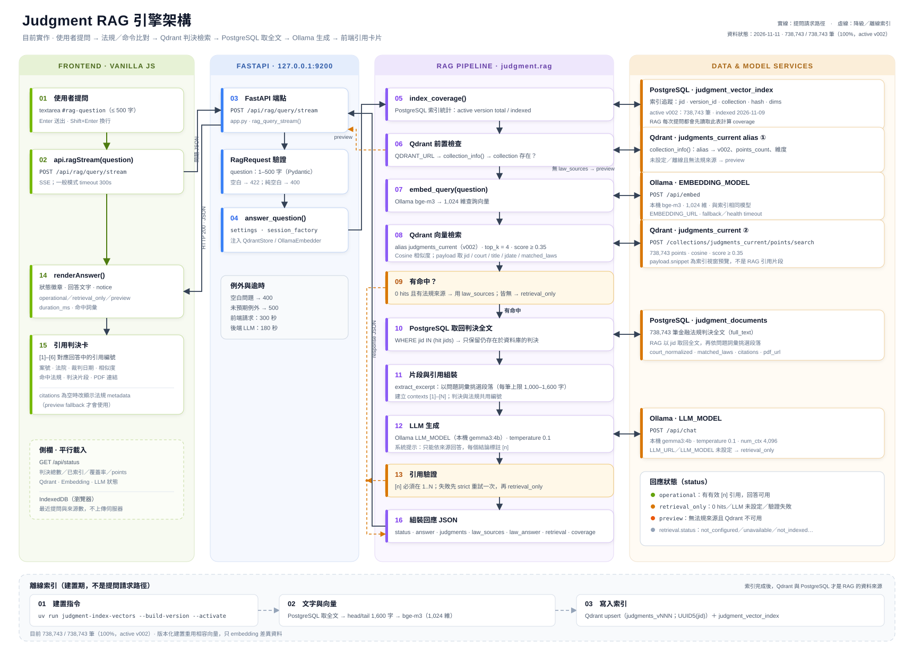
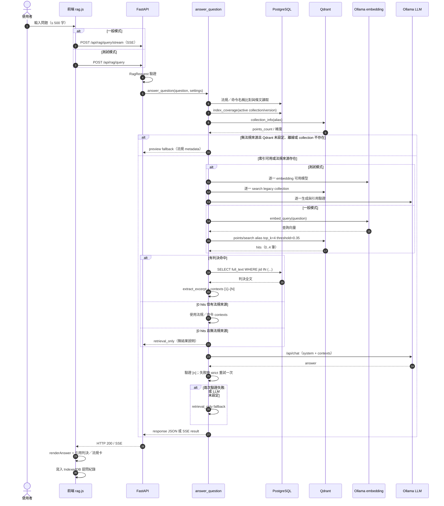

# Judgment RAG 引擎架構

> 從使用者提問、法規／命令比對、Qdrant 判決向量檢索、PostgreSQL 與 Parquet 取回全文，到 Ollama 生成回答並回到前端引用卡片的目前實作。
>
> 對應程式：`src/judgment/rag.py`、`src/judgment/law_rag.py`、`src/judgment/judgment_index.py`、`src/judgment/index_versions.py`、`src/judgment/performance_test.py`、`src/judgment/web/app.py`、`src/judgment/web/static/assets/js/pages/rag.js`



圖檔：`documents/rag-architecture.svg`（可直接用瀏覽器開啟，或內嵌於 Markdown／HTML）

## 1. 全域視圖

| 層 | 角色 | 主要元件 |
| --- | --- | --- |
| 前端 | 取得問題、顯示回答與引用 | Vanilla JS SPA、`pages/rag.js`、`api.js`、IndexedDB |
| API | 驗證請求、呼叫 RAG、回傳 JSON 或 SSE | FastAPI、`POST /api/rag/query`（測試模式）、`POST /api/rag/query/stream`（一般模式） |
| RAG 管線 | 法規／命令比對、檢索、取全文、組片段、生成、驗證 | `judgment.rag.answer_question()`、`judgment.law_rag` |
| 資料層 | 法規／命令 metadata、條文、判決全文與索引追蹤 | PostgreSQL `law_documents`、`judgment_documents`、`judgment_vector_index`、`judgment_index_versions`；法規與判決 Parquet 快照 |
| 向量層 | 文件級向量檢索 | Qdrant alias `judgments_current` -> 版本化 collection `judgments_vNNN`；legacy `judgment_documents` |
| 模型層 | 查詢 embedding 與回答生成 | Ollama；embedding 由 `EMBEDDING_MODEL` 設定（預設 `bge-m3`），LLM 由 `LLM_MODEL` 設定（本機 `.env` 目前 `gemma3:4b`） |

RAG **不是**直接把問題丟給 LLM。LLM 只會看到法規／命令條文，以及 Qdrant 檢索到、且仍存在於 PostgreSQL 的判決片段；回傳前還會檢查引用編號是否合法。法規／命令問題會先比對 `law_documents` 與法規 Parquet，不依賴判決索引覆蓋率。

## 2. 端到端流程

編號對應上方 SVG。

| # | 位置 | 動作 | 實作 |
| --- | --- | --- | --- |
| 01 | 前端 | 使用者輸入問題（≤ 500 字） | `#rag-question`、Enter 或「開始檢索」 |
| 02 | 前端 | 一般模式呼叫 SSE；測試模式呼叫非串流 API | `api.ragStream()` → `POST /api/rag/query/stream`；測試模式 `api.rag()` → `POST /api/rag/query` |
| 03 | FastAPI | 接收請求 | `app.py`：`rag_query_stream()`／`rag_query()` |
| — | FastAPI | `RagRequest` 驗證 | Pydantic `min_length=1, max_length=500`；長度或空字串錯誤回 422，純空白則由 RAG 拋 `ValueError` 回 400 |
| 04 | FastAPI | 呼叫 `answer_question()` | 傳入 `session_factory`、`settings`、partial／token callbacks |
| 04a | RAG | 法規／命令名稱比對 | `find_law_records()`／`law_sources_for_question()`：`law_documents`、簡稱 alias、概念展開 |
| 04b | RAG | 讀取法規條文與沿革 | `load_law_contents()`：最新法規 `raw_parquet` 的 `law_articles`、`law_histories` |
| 04c | RAG | 結構化問題或引用統計 | 條文數／制定日期／相關法規／引用統計 → 直接回傳 `answer_source=structured`、`retrieval.status=law_only` |
| 04d | RAG | 法規／命令向量檢索 | `_embed_question()` 共用查詢向量、`_search_legal_articles()`：alias `legal_articles_current`；BM25／概念排名與 dense 排名以 RRF 融合，再分 `law`／`order` 群組 rerank |
| 05 | RAG | 讀取索引覆蓋率 | `index_coverage()`：以 active physical collection／version 過濾 `judgment_vector_index` |
| 06 | RAG | Qdrant 前置檢查 | `QdrantStore.collection_info()`：只檢查 active alias／collection；沒有法規來源且 Qdrant 不可用時才進 `preview` |
| 07 | RAG | 將問題轉為查詢向量 | `OllamaEmbedder.embed_query()` → `POST /api/embed` |
| 08 | RAG | 向量檢索 | `QdrantStore.search()`：alias `judgments_current`、`top_k=4`、`score_threshold=0.35` |
| 09 | RAG | 判斷是否有命中 | 0 hits 但有法規來源 → 使用法規／命令繼續回答；兩者皆無 → `retrieval_only`，不呼叫 LLM |
| 10 | RAG | 取回判決全文 | PostgreSQL：`WHERE jid IN (...)`，只保留仍存在的判決 |
| 11 | RAG | 組裝片段與引用 | `extract_excerpt()`、`_build_citations()`、`law_source_text()`；判決與法規共用 `[1]–[N]` 編號 |
| 12 | RAG | LLM 生成 | Ollama `POST /api/chat`；一般模式 `stream=true` 逐 token 回傳，測試模式依模型逐一生成 |
| 13 | RAG | 引用驗證 | `_valid_citation_markers()`：`[n]` 必須在 `1..N`；失敗時以 strict prompt 重試一次，再失敗才降級 |
| 14 | 前端 | 顯示回答 | `renderAnswer()`：狀態徽章、回答、notice、耗時 |
| 15 | 前端 | 顯示引用卡 | 判決卡：案號、法院、裁判日期、相似度、實際引用法規／條號／項次、片段、PDF；法規／命令卡：條文數、制定日期、條文、引用統計、來源。上方已顯示法規檢索結果時，不再重複下方法規來源卡。 |
| 16 | RAG | 組裝回應 JSON 或 SSE | `status`、`answer`、`notice`、`judgments`、`law_sources`、`law_answer`、`law_framework`、`retrieval`、`coverage`、`duration_ms`；串流另有 `partial`／`token`／`result` |
| — | 前端 | 側欄與歷史 | `GET /api/status` 取 hero 索引資訊；IndexedDB 存最近提問 |

## 3. 元件與程式位置

| 元件 | 檔案 | 責任 |
| --- | --- | --- |
| RAG 頁面 | `src/judgment/web/static/assets/js/pages/rag.js` | 問題輸入、呼叫 API、渲染回答與引用、側欄狀態、IndexedDB 歷史 |
| API 客戶端 | `src/judgment/web/static/assets/js/api.js` | `api.rag()`、`api.status()`、API base 與 timeout |
| HTTP 端點 | `src/judgment/web/app.py` | `POST /api/rag/query`（測試模式／非串流）、`POST /api/rag/query/stream`（一般模式 SSE）、錯誤轉 HTTP 400／422／500 與效能紀錄目標 |
| RAG 管線 | `src/judgment/rag.py` | `answer_question()`、`_search_hits()`、`_build_citations()`、`_generate_answer()`、引用驗證、fallback |
| Embedding | `src/judgment/embeddings.py` | Ollama `/api/embed`、模型存在檢查、向量數量與維度一致性檢查 |
| Qdrant 客戶端 | `src/judgment/vector_store.py` | collection 建立／查詢、payload index、`points/search` |
| 法規／命令 RAG | `src/judgment/law_rag.py` | 名稱／簡稱比對、Parquet 條文、制定日期、判決引用統計、結構化回答 |
| 索引器（legacy） | `src/judgment/judgment_index.py` | `build_index_text()`、`index_judgments()`、`index_coverage()`、`--stride` 抽樣 |
| 索引版本 | `src/judgment/judgment_index.py`、`src/judgment/index_versions.py` | `build_index_version()`、`judgments_vNNN`、validation、alias activation／rollback |
| 測試模式 | `src/judgment/performance_test.py` | `run_test_mode()`、模型探測、`performance_test_runs`／`performance_test_steps` |
| 設定 | `src/judgment/config.py` | Qdrant、embedding、LLM、RAG 參數 |
| 資料模型 | `src/judgment/models.py` | `LawDocument`、`JudgmentDocument`、`JudgmentVectorIndex`、`JudgmentIndexVersion` |

## 4. 請求與回應契約

### 請求

```http
POST /api/rag/query/stream
Content-Type: application/json
Accept: text/event-stream
```

一般模式使用 SSE；測試模式改用非串流 `POST /api/rag/query`。兩者 body 相同：

```json
{
  "question": "侵權行為損害賠償的舉證責任"
}
```

`RagRequest` 限制 `question` 長度 1–500；空白字串由 Pydantic 回 422，純空白則由 `answer_question()` 回 400。

### 回應（成功且通過引用驗證）

```json
{
  "status": "operational",
  "answer": "根據法規／命令與判決片段，主張有利於己之事實者負有舉證責任 [1, 2, 3]。……這不是法律意見。",
  "notice": "回答只根據檢索到的法規／命令與判決片段生成，引用編號可對應下方來源。這不是法律意見。",
  "citations": [],
  "judgments": [
    {
      "index": 1,
      "jid": "TPDV,114,訴,1,20260101,1",
      "court": "臺灣臺北地方法院",
      "jdate": "20260101",
      "title": "清償借款",
      "score": 0.6123,
      "snippet": "原告主張……",
      "matched_laws": ["銀行法"],
      "law_citations": [
        {
          "law_name": "銀行法",
          "article_no": "第125條",
          "paragraphs": ["第1項", "第3項"]
        }
      ],
      "citation_count": 3,
      "pdf_url": "https://data.judicial.gov.tw/..."
    }
  ],
  "law_sources": [
    {
      "index": 5,
      "law_name": "銀行法",
      "source_type": "law",
      "source_label": "法規",
      "article_count": 204,
      "law_modified_date": "20230628",
      "first_promulgation": {
        "roc_date": "中華民國二十年三月二十八日",
        "gregorian_date": "1931-03-28"
      },
      "articles": [
        {"article_no": "第29條", "article_content": "……"}
      ]
    }
  ],
  "matched_terms": ["銀行法"],
  "law_answer": "銀行法與授信、存款相關條文摘要……",
  "law_framework": null,
  "answer_source": "llm",
  "llm_model": "gemma3:4b",
  "embedding_model": "bge-m3",
  "retrieval": {
    "status": "ok",
    "latency_ms": 34,
    "top_k": 4,
    "score_threshold": 0.35,
    "hits": 4,
    "unique_judgments": 4,
    "law_hits": 1,
    "top_score": 0.6123
  },
  "coverage": {
    "total_judgments": 738743,
    "indexed_judgments": 738743,
    "remaining_judgments": 0,
    "collection": "judgments_v002",
    "model": "bge-m3",
    "version_id": 4,
    "latest_indexed_at": "2026-11-09T12:10:38.042901+00:00"
  },
  "duration_ms": 2415
}
```

補充：

- `judgments` 是 RAG 的判決引用；`law_sources` 是法規／命令引用，包含 metadata、條文、制定日期與引用統計；`law_answer` 與 `law_framework` 是法規摘要與責任架構。一般 RAG 模式的最終回應 `citations` 固定為空陣列；只有 `preview` fallback 會放法規 metadata。
- `judgments[].law_citations` 是該判決 `citations` 欄位的實際引用明細，包含 `law_name`、`article_no` 與判決全文中緊接的 `paragraphs`（例如 `第125條`＋`第1項、第3項`）；前端據此顯示可點擊的「法規＋條號＋項次」chips，而不是只顯示法規名稱。
- `answer_source` 為 `structured` 時，回答由法規／命令 metadata、條文與判決引用統計直接整理；為 `llm` 時由模型生成；為 `retrieval` 時只顯示檢索結果。SSE partial 事件另外使用 `partial`／`streaming`。
- `retrieval.hits` 是 Qdrant 原始命中數；`unique_judgments` 是去重後的 Qdrant 命中數，計算時尚未扣掉 PostgreSQL 已不存在的判決。
- `judgments[].snippet` 是 `extract_excerpt()` 從 PostgreSQL 全文挑出的片段（最多 420 字），不是 Qdrant payload 的索引預覽。
- 判決與法規來源共用同一組 `[n]` 編號：判決先編號，法規／命令接在其後；前端以 `index` 對應來源卡。
- 回答標頭在狀態與耗時旁顯示 `llm_model`；tooltip 另列出 `embedding_model`。結構化回答顯示「法規資料庫」。測試模式回應沒有 `answer_source`，模型資訊在測試 Flow 的 `test_run.primary_model`。

### 狀態值

| `status` | 意義 | LLM 是否呼叫 |
| --- | --- | --- |
| `operational` | 有檢索結果且 LLM 回答通過引用驗證，或法規結構化回答成功，或法規／命令來源足以產生回答 | 不一定（結構化回答不呼叫 LLM） |
| `retrieval_only` | 只回傳檢索結果或無結果說明 | 不一定（0 hits 時否；LLM 失敗時已呼叫但丟棄） |
| `preview` | 沒有法規來源，且 Qdrant 未設定／不可用／collection 不存在／向量檢索失敗，降級為法規 metadata 預覽 | 否 |

`retrieval.status` 另外可能出現：

| 值 | 觸發條件 |
| --- | --- |
| `not_configured` | `QDRANT_URL` 未設定 |
| `unavailable` | Qdrant 無法連線 |
| `not_indexed` | collection 尚未建立 |
| `degraded` | Embedding 或 Qdrant 檢索過程發生錯誤 |
| `ok` | 檢索成功（不論 hits 是否為 0） |
| `law_only` | 法規／命令結構化回答，未進行判決向量檢索 |
| `pending` | SSE partial 階段，判決檢索尚未完成 |
| `empty` | 測試模式沒有檢索命中 |
| `failed` | 測試模式發生未預期錯誤 |

HTTP 層：

- `422`：Pydantic 驗證失敗（空字串、超過 500 字、缺少 question）。
- `400`：純空白問題或 `answer_question()` 拋出 `ValueError`。
- `500`：非串流 `/api/rag/query` 的未預期例外。
- 串流 `/api/rag/query/stream` 的執行期錯誤以 SSE `error` 事件回傳，HTTP 狀態仍為 200。

## 5. 檢索與生成細節

### 5.1 查詢向量

- 模型：本機 `EMBEDDING_MODEL=bge-m3`（1,024 維，與索引使用同一個模型）。
- 端點：`POST {EMBEDDING_URL}/api/embed`。
- 前端問題直接作為 embedding 輸入，不做關鍵字查詢改寫。

### 5.2 Qdrant 檢索

- Collection：`judgments_current` alias 指向目前 active 的版本化 collection（目前為 `judgments_v002`）；若 alias 不存在，才使用 `JUDGMENT_VECTOR_COLLECTION`（預設 legacy `judgment_documents`）。
- 距離：Cosine。
- 參數：`top_k=4`、`score_threshold=0.35`。
- 每個 point 對應一筆判決，point id 為 `uuid5(NAMESPACE_URL, "judgment:<jid>")`，重跑為 idempotent upsert。
- Payload：`jid`、`court`、`title`、`jdate`、`matched_laws`、`citation_count`、`source_archive`、`source_year`、`pdf_url`、`full_text_length`、`snippet`、`model`、`embedding_version`、`index_recipe_version`。
- `snippet` 是索引文字的前 600 字預覽；RAG 回答不使用它，而是回到 PostgreSQL 取全文。
- `unique_judgments` 是 Qdrant 命中去重後的數量，尚未扣除 PostgreSQL 已刪除的判決。

### 5.3 全文與片段

- 以 Qdrant 命中的 `jid` 到 PostgreSQL `judgment_documents` 取回 `full_text`。
- 若判決已從 PostgreSQL 刪除但 Qdrant 仍有 point，該筆會被跳過；全部被跳過時，若沒有法規來源則回傳 `retrieval_only`，不生成答案。
- 有法規／命令來源時，即使 0 筆判決命中，仍會使用法規內容繼續回答。
- `extract_excerpt()` 以問題中的中文雙字詞與英文詞彙計分，挑選最相關段落；每筆判決的預算為 `max(600, RAG_MAX_CONTEXT_CHARS / 命中數)`，上限 1,600 字。
- 目前 4 筆命中時，每筆約 1,000 字，總上下文約 4,000 字。
- 判決片段與法規來源會合併成 contexts，引用編號共用 `[1]–[N]`。
- 點擊 RAG 判決卡的案號標題會走 `GET /api/judgment?source=parquet`，從 `data/judgments/parquet/raw_judgments/<archive>/<partition>/<snapshot>/raw.parquet` 依 `jid` 讀取完整判決並以 dialog 顯示；RAG 生成仍使用 PostgreSQL 的全文，不由 Parquet 取代。

### 5.4 LLM 生成

- 端點：`POST {LLM_URL}/api/chat`。
- 模型：由 `LLM_MODEL` 設定；本機 `.env` 目前為 `gemma3:4b`，可改成 27B 品質模式。
- 參數：`temperature=0.1`、`num_ctx=4096`、`num_predict=384`、`keep_alive=30m`；一般模式 `stream=true` 並以 SSE 逐 token 回傳，測試模式使用非串流生成。
- 系統提示要求：
  - 只能根據提供的判決片段、法規與命令內容回答。
  - 不得創造案號、法院、日期或法條。
  - 每個結論後標註 `[n]`。
  - 資料不足時直接說「檢索到的資料不足以回答」。
  - 使用繁體中文，2–4 句，並提醒不是法律意見。

### 5.5 引用驗證

`_valid_citation_markers(answer, N)` 的規則：

1. 解析 `[1]`、`[1, 2, 3]`、`[1，2]` 等格式。
2. 所有編號必須落在 `1..N`；`N` 是判決引用數加上法規來源數。
3. 若沒有任何編號，只有當回答包含「不足以回答／無法回答／沒有足夠／查無相關／未提及／無法判斷」等明確拒答語句，且不含案號格式時，才視為合法。
4. 驗證失敗時，先以 strict 提示重試一次；第二次仍失敗才降級為 `retrieval_only`，改用 `_retrieval_answer()` 顯示檢索摘要，不保留 LLM 的回答。

### 5.6 測試模式

當 PostgreSQL `app_settings.test_mode` 為 ON，且 `QDRANT_URL` 已設定、collection 檢查成功時，`answer_question()` 會分支到 `performance_test.run_test_mode()`。若 Qdrant 未設定／不可用／collection 不存在，測試模式不會啟動，仍走一般法規或 preview 路徑。

1. `available_test_models()` 以 Ollama 能力快取／`/api/show`／必要時 `/api/chat` 探測模型；reranker 一律排除，LLM 僅保留具備 chat 能力者，並支援 `TEST_EMBEDDING_MODELS`／`TEST_LLM_MODELS` 覆寫。
2. 對每個 embedding 模型執行 embedding 與 Qdrant 檢索；檢索使用 `settings.judgment_vector_collection`（legacy `judgment_documents`），不是 `judgments_current` alias。
3. 參考全文優先使用 `settings.embedding_model` 的命中；若它沒有命中，改用第一個有命中的 embedding 模型取回 PostgreSQL 全文與 contexts。
4. 依序對每個 LLM 模型執行生成與引用驗證；embedding 與 LLM 呼叫皆使用 `timeout=None`。
5. 每個 embedding 模型建立 `embedding`／`retrieval` step；PostgreSQL `context` 共用一筆；每個 LLM 建立 `llm`／`validation` 一筆。整體寫入 `performance_test_runs`，效能報表頁會 polling 顯示即時 Flow。
6. 主要回答優先使用 `LLM_MODEL`，其次使用第一個通過引用驗證的模型；全部失敗時降級為 `retrieval_only`。`test_run.primary_model` 可能仍指向有產出但未通過驗證的模型，回應是否可信以 `status` 為準。

測試模式的模型清單與流程圖表細節見 `README.md` 的〈測試模式與模型測試 Flow〉。


| 情況 | `status` | `retrieval.status` | 前端行為 |
| --- | --- | --- | --- |
| 一切正常、LLM 回答有合法 `[n]` | `operational` | `ok` | 顯示回答與 4 筆判決卡 |
| 有判決命中，但 LLM 未設定 | `retrieval_only` | `ok` | 顯示檢索摘要與判決卡，不生成答案 |
| 有判決命中，但 LLM 失敗或引用兩次驗證皆無效 | `retrieval_only` | `ok` | 顯示降級 notice、檢索摘要與判決卡 |
| 有法規來源、0 筆判決命中 | `operational` 或 `retrieval_only` | `ok`（hits=0）或原 Qdrant 狀態 | 使用法規／命令內容回答或顯示檢索摘要 |
| 無法規來源且無相似度足夠的判決 | `retrieval_only` | `ok`（hits=0） | 顯示無結果說明，不呼叫 LLM |
| 無法規來源且 `QDRANT_URL` 未設定 | `preview` | `not_configured` | 顯示法規 metadata 預覽 |
| 無法規來源且 Qdrant 無法連線 | `preview` | `unavailable` | 顯示法規 metadata 預覽 |
| 無法規來源且 collection 尚未建立 | `preview` | `not_indexed` | 提示先執行 `judgment-index-vectors` |
| 無法規來源且 Embedding／Qdrant 檢索失敗 | `preview` | `degraded` | 顯示法規 metadata 預覽 |
| 純空白問題 | HTTP 400 | — | 前端顯示錯誤 toast／錯誤卡 |
| Pydantic 驗證失敗（空字串、超過 500 字） | HTTP 422 | — | 前端顯示錯誤 toast／錯誤卡 |
| 非串流端點未預期例外 | HTTP 500 | — | 前端顯示錯誤卡 |
| 串流端點執行期例外 | HTTP 200 + SSE `error` | — | 前端顯示錯誤卡／降級訊息 |

`preview` fallback 會呼叫 `web.query.rag_preview()`，只以現行 `law_documents` 的法規名稱做精確比對，不會解析簡稱 alias、概念展開，也不會生成判決答案。

## 6. 混合版本備份

判決 archive 更新時，系統不保存每個版本的完整 RAR：

- `judgment_snapshots` 記錄 issue month、archive SHA-256、update date、raw/delta Parquet 與 current 狀態。
- `judgment_documents` 只保留 current；被修改/移除的舊全文 lazy 寫入 `judgment_document_versions`，並在 `judgment_change_events` 記錄 added/modified/removed/restored。
- Raw Parquet 保留 current full snapshot；舊 raw JSON 變更寫入 `parquet/raw_judgment_deltas/{YYYYMM}/`。Delta 驗證成功後才移除舊 full Parquet；`JUDGMENT_RAW_PARQUET_KEEP_VERSIONS=true` 可保留舊 full。
- 下載到同月份新 RAR 時，舊 RAR/7z/zip 預設移到 `raw_rar/history/`，並記錄在 `download_manifest.json` 的 `history_files`；設為 `JUDGMENT_RAW_RAR_KEEP_VERSIONS=false` 才刪除舊容器。
- Qdrant 新索引版本會把 changed/removed 的舊向量寫入 `JUDGMENT_VECTOR_HISTORY_COLLECTION`；current 查詢仍經 `judgments_current` alias。
- IndexedDB 的 `audit_events` store 從 `/api/versioning/audit` 同步版本變更 metadata。
- 一般查詢與 RAG 只使用 `is_current=true`；歷史資料由 `/api/versioning/*` 查詢。完整規格見 `specs/006-hybrid-backup-versioning/spec.md`。
- 線上更新檢查：`up.sh` 呼叫 `/api/updates/check`，將法規／命令／判決狀態寫入 `download_update_records`；API 可用 `source_types` 只檢查指定來源。header「資料處理」顯示橘色更新 badge，processing sidebar 的對應流程顯示「更新」。按下下載流程的「執行此流程」時會先檢查該來源，`up_to_date` 時要求確認是否強制重新下載。workflow 面板顯示各階段獨立進度條與整體加總堆疊條；hover 會隔離該階段並顯示浮動說明。法規／命令流程只包含 ZIP、原始 Parquet、解析與 PostgreSQL；內容未變更時略過解析與 PostgreSQL，且不寫入 Qdrant／IndexedDB。法規／命令 ZIP 存在 `raw/{source}/{YYYYMMDD}/{原始檔名}`，同名不同內容以 hash suffix 保留。規格見 `specs/007-update-notifications/spec.md`。
- 條文歷史狀態檢查：`/api/law-versions/check` 依 `law_dataset_versions.update_date`（fallback 下載時間）分月統計法規／命令版本數、已建立／未建立版本、需建立／可建立／缺原始檔版本、條文列與預期條文數；processing 的建立條文歷史分頁以年份×月份表格顯示綠色已建立、紅色未建立、灰色部分建立，目前版本以靜態外框標示，並列出需建立歷史的版本及原始 Parquet 可用性。
- 法院名稱檢查：`/api/courts/check` 依 `issue_month` 統計 `judgment_documents` 的總筆數、已檢查、未檢查、無效值與需正規化筆數；processing 的法院名稱正規化分頁以年份×月份表格顯示綠色已檢查、紅色未檢查、灰色需正規化。
- 判決匯入時間表：以 `raw_rar/download_manifest.json` 的 368 個月與 PostgreSQL `judgment_documents.source_archive` 比對，processing 頁顯示年份列×月份欄表格；綠色已匯入、紅色未匯入、灰色有新檔／遠端新版本待匯入，目前匯入月份有脈動框，tooltip 顯示本機檔案、已匯入檔案與 fileset。
- Qdrant 版本建置：開始前依 Ollama 主機優先順序測試各台的 `/api/tags` 與 embedding 模型，選擇第一台可用主機並記錄 URL、host、port、模型清單與實際使用主機；embedding 失敗時會依序改用下一台。處理狀態新增 `ollama`、`qdrant`、`validate` 三個階段，並在 run meta 的 `index_runtime` 依 `issue_month`／`source_archive` 累計索引進度；processing 頁以與判決下載相同的年份列×月份欄時間表呈現，綠色完成、紅色未完成、灰色新檔，tooltip 顯示來源檔案、筆數、重用／新 embedding 與目前 JID。`/api/system-usage` 提供 Qdrant Docker context、container、image、`/qdrant/storage`、volume 名稱／容量與 host 來源路徑。規格見 `specs/004-web-console/spec.md`。

## 7. 離線索引流程

RAG 的資料來源不是即時從判決壓縮檔讀取，而是先建立索引。系統同時保留 legacy 與版本化兩條路徑：

```text
Legacy：
PostgreSQL judgment_documents
  → build_index_text()：法院、日期、案由、命中法規、全文 head/tail（1,600 字）
  → Ollama EMBEDDING_MODEL /api/embed
  → Qdrant upsert（legacy collection：judgment_documents）
  → PostgreSQL judgment_vector_index（jid、version_id、collection、model、content_hash、dimensions、indexed_at）

版本化（正式查詢）：
PostgreSQL judgment_documents
  → build_index_version()：建立 judgments_vNNN
  → 相容時複製舊 collection points，只 embedding 新增／變更資料
  → validate_version()：PostgreSQL count、Qdrant count、dimension、payload 抽樣
  → activate_version()：原子切換 judgments_current alias
  → judgment_index_versions（版本、physical collection、snapshot、validation、previous_version_id）
```

指令：

```bash
# Legacy：只統計，不呼叫 Ollama／Qdrant
uv run judgment-index-vectors --dry-run --limit 1000

# Legacy：預設會從尚未索引的判決續跑
uv run judgment-index-vectors --limit 1000 --batch-size 16

# Legacy：跨語料抽樣（id 為 stride 的倍數）
uv run judgment-index-vectors --stride 24 --batch-size 16

# Legacy：--all 會重新掃描所有判決，不會跳過未變更者
uv run judgment-index-vectors --all --batch-size 16

# Legacy：--recreate 會刪除 legacy collection 後重建
uv run judgment-index-vectors --recreate --batch-size 16

# 版本化：建立新版本，驗證成功後切換 alias
uv run judgment-index-vectors --build-version --activate --batch-size 64

# 版本化：手動驗證／啟用／回滾
uv run judgment-index-vectors --validate-version 4
uv run judgment-index-vectors --activate-version 4
uv run judgment-index-vectors --rollback
```

目前狀態（2026-11-11）：

| 項目 | 數值 |
| --- | --- |
| PostgreSQL 判決總數 | 738,743 |
| active 版本 | `version_id=4`、`judgments_v002` |
| 已索引／覆蓋率 | 738,743／738,743（100%） |
| Qdrant points | 738,743 |
| 向量維度 | 1,024 |
| 索引模型 | `bge-m3` |
| Alias | `judgments_current` -> `judgments_v002` |
| Legacy collection | `judgment_documents`（version 2，retired，仍保留 points） |
| `judgment_vector_index` 總列數 | 1,477,486（legacy 與 active 版本合計） |

## 8. 設定與目前值

| 變數 | 程式預設／本機 `.env` | 用途 |
| --- | --- | --- |
| `QDRANT_URL` | 預設空；本機 `http://127.0.0.1:6333` | Qdrant REST |
| `QDRANT_API_KEY` | 空 | Qdrant API key |
| `JUDGMENT_VECTOR_ALIAS` | `judgments_current` | 正式查詢 alias |
| `JUDGMENT_VECTOR_COLLECTION` | `judgment_documents` | legacy／未版本化時的實體 collection |
| `JUDGMENT_VECTOR_COLLECTION_PREFIX` | `judgments` | 版本化實體 collection 前綴 |
| `JUDGMENT_EMBEDDING_VERSION` | `bge-m3@v1` | 向量重用與版本相容指紋 |
| `JUDGMENT_INDEX_RECIPE_VERSION` | `doc-head-tail-v1` | index text 規則版本 |
| `JUDGMENT_POINT_ID_VERSION` | `jid-uuid5-v1` | point ID 規則版本 |
| `EMBEDDING_URL` | 預設空；本機 `.env` 指向 x570 或本機 Ollama | 主要 Ollama embedding API |
| `EMBEDDING_FALLBACK_URL` | 空；`up.sh` 會設定本機 fallback | 主要 embedding 失敗時使用第一台備援 |
| `EMBEDDING_FAILOVER_URLS` | 空 | 額外 embedding 備援（逗號分隔）；DB Ollama 主機優先順序會自動覆寫 |
| `EMBEDDING_MODEL` | `bge-m3` | 查詢與索引 embedding |
| `EMBEDDING_TIMEOUT_SECONDS` | `120` | Embedding 請求逾時 |
| `EMBEDDING_QUERY_TIMEOUT_SECONDS` | `2` | 非本機查詢 embedding 逾時 |
| `EMBEDDING_HEALTH_TIMEOUT_SECONDS` | `2` | 非本機 Ollama 健康檢查逾時 |
| `LLM_URL` | 預設空；本機 `.env` `http://127.0.0.1:11434` | Ollama API |
| `LLM_MODEL` | 預設空；本機 `.env` `gemma3:4b` | 回答模型；品質優先可改 27B |
| `LLM_TIMEOUT_SECONDS` | `180` | LLM 請求逾時 |
| `LLM_NUM_CTX` | `4096` | Ollama context window |
| `LLM_NUM_PREDICT` | `384` | 最多生成 tokens |
| `LLM_KEEP_ALIVE` | `30m` | 模型保持載入時間 |
| `RAG_TOP_K` | `4` | 檢索候選數 |
| `RAG_SCORE_THRESHOLD` | `0.35` | 相似度下限 |
| `RAG_MAX_CONTEXT_CHARS` | `4000` | 提供給 LLM 的片段總預算 |
| `JUDGMENT_INDEX_MAX_CHARS` | `1600` | 每筆判決索引文字上限 |
| `TEST_EMBEDDING_MODELS` | 空 | 測試模式 embedding 模型覆寫 |
| `TEST_LLM_MODELS` | 空 | 測試模式 LLM 模型覆寫 |

## 9. 循序圖



## 10. 已知限制

1. **全量索引已完成**：目前 `judgment_vector_index` 與 Qdrant 為 738,743／738,743（100%）；正式查詢使用 `judgments_current` alias，新版本以 Blue-Green collection 建置。
2. **文件級向量而非片段級**：每筆判決只取 head/tail 1,600 字作為 embedding，判決中段的細節可能不會被檢索到。
3. **Reranker 只覆蓋候選排序**：判決候選與法規／命令候選由 `bge-reranker-v2-m3` 重新排序，法規與命令再依 `source_type` 分組；關閉、逾時或服務失敗時保留檢索原順序。檢索本身仍是 BM25／dense（RRF）與 Qdrant cosine，不是端到端學習式檢索。
4. **引用驗證是結構驗證**：只檢查 `[n]` 是否落在範圍內、拒答是否含案號；不驗證每個句子是否真的由對應片段支持。
5. **LLM 生成速度與品質權衡**：快速 profile（`gemma3:4b`、top_k=4、4,000 字上下文、num_ctx=4096）實測整體 RAG 約 2–5 秒；切回 `gemma3:27b` 約 30–50 秒。一般模式前端等待上限為 300 秒，測試模式則對 embedding 與 LLM 使用無 timeout。4B 的複雜推理品質可能低於 27B，可透過 `LLM_MODEL` 切換。
6. **串流回應**：API 使用 SSE `partial`／`token`／`result`，前端先顯示法規結果，再逐字顯示 LLM 回答。
7. **Qdrant 與 PostgreSQL 可能短暫不同步**：索引器先寫 Qdrant 再寫 `judgment_vector_index`；RAG 以 PostgreSQL 全文為最終依據，找不到的判決會被跳過。
8. **沒有使用者認證**：RAG 查詢端點本身唯讀，但整個 Web API 含大量寫入端點（題庫、benchmark、Ollama 主機、processing、index versions、test mode 等），且目前沒有認證；若透過 tunnel 對外開放，任何知道網址的人都能操作。正式部署應加上存取控制與速率限制。

## 11. 驗證方式

```bash
# 單元測試：索引器、續跑、RAG 引用驗證、fallback
uv run pytest tests/test_rag.py -q

# 全部測試與靜態檢查
uv run pytest -q
uv run ruff check .

# 直接呼叫 API
curl -s http://127.0.0.1:9200/api/rag/query \
  -H 'Content-Type: application/json' \
  -d '{"question":"侵權行為損害賠償的舉證責任"}'
```

前端驗證重點：

- RAG 頁 hero notice 顯示判決總數、已索引數與整體 RAG 狀態；`GET /api/status` 另提供 collection points、Qdrant／Embedding／LLM 詳細狀態。
- 回答卡顯示狀態徽章、回答、notice 與引用判決／法規卡。
- 引用卡的 `[n]` 與回答中的編號一致；判決與法規共用同一組編號。
- 390px 寬度沒有水平溢出，瀏覽器 console 沒有錯誤。
- Qdrant 資料頁的語意查詢可點選案號開啟判決原文，返回後查詢條件保留。

## 12. 相關文件

- `README.md`：安裝、啟動、索引指令、降級矩陣與驗證紀錄。
- `specs/004-web-console/spec.md`：Web 主控台規格與 RAG 驗收條件。
- `documents/rag-architecture.svg`：本文件使用的架構圖。
